# Ecualizador de audio de tres bandas con analizador de espectro en ESP32

**Fase 2 del proyecto de aula (ABPr): desarrollo de la propuesta seleccionada**

Electrónica II · Ingeniería Electrónica · Universidad de la Costa (CUC) · Periodo 2026-2

**Integrantes:** David Orozco · Jose Torres · Leo Rojas

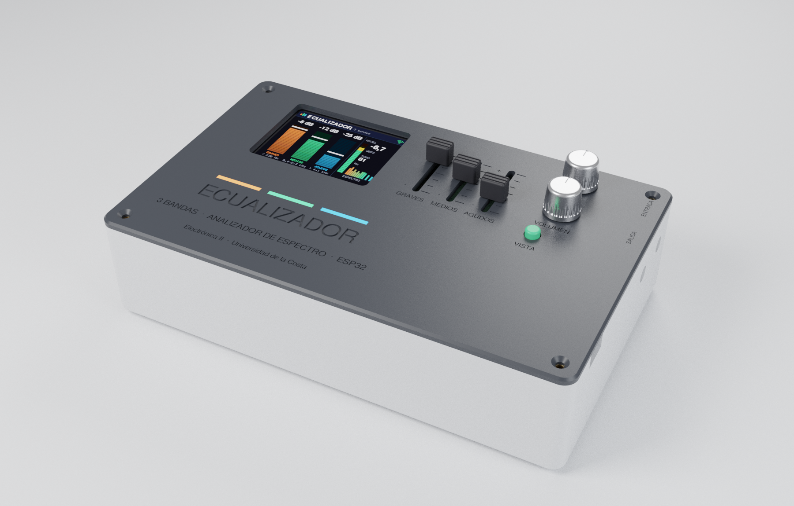

---

## Contenido

1. [Introducción](#1-introducción)
2. [Objetivos](#2-objetivos)
3. [Planteamiento del problema](#3-planteamiento-del-problema)
4. [Marco teórico](#4-marco-teórico)
5. [Estado del arte](#5-estado-del-arte)
6. [Listado de materiales](#6-listado-de-materiales)
7. [Componente técnico](#7-componente-técnico)
8. [Validación y criterios de aceptación](#8-validación-y-criterios-de-aceptación)
9. [Referencias](#9-referencias)
10. [Anexo: archivos fuente y cómo regenerar todo](#10-anexo-archivos-fuente-y-cómo-regenerar-todo)

---

## 1. Introducción

En la Fase 1 se presentaron tres alternativas para acondicionar, con amplificadores
operacionales, una señal de audio o biomédica y entregarla a un ESP32. Para el desarrollo se
eligió la **Propuesta 2, el ecualizador de audio de tres bandas con filtros activos**, porque es la
que más contenido de la asignatura reúne: preamplificador no inversor, filtros Sallen-Key pasa
bajas y pasa altas, un pasa banda en cascada, un sumador inversor y detectores de pico de
precisión. En total el circuito usa **15 amplificadores operacionales** (cuatro MCP6004) con una
sola fuente de 3,3 V.

A la propuesta original se le agregó el **analizador de espectro de la Propuesta 1**, que no
necesita hardware nuevo salvo un filtro antialiasing: el ESP32 toma la salida ya ecualizada,
calcula una FFT de 1024 puntos y la dibuja en la pantalla TFT junto con las tres barras de nivel
que entregan los detectores de pico. Así, al mover un deslizable se ve en tiempo real cómo cambia
la banda y el espectro, que es la forma más directa de comprobar que los filtros hacen lo que se
calculó. El equipo es además útil por sí solo: se conecta un celular o un PC a la entrada y se
escucha el resultado por un parlante interno (módulo PAM8403) o por la salida de línea, y la misma
información se puede ver desde el teléfono en una página que sirve el ESP32 por Wi-Fi.

Este documento presenta los objetivos, el marco teórico ampliado, el estado del arte, la lista de
materiales, el diseño (esquemático, cálculos, simulación, PCB, modelo 3D y gabinete), el firmware
y la guía de montaje en protoboard. Todo el diseño sale de una sola descripción del circuito
([`herramientas/circuito.py`](herramientas/circuito.py)): la simulación, el esquemático de KiCad y
la PCB se generan desde ese archivo, y un script comprueba que la netlist del esquemático coincide
pin a pin con él.

## 2. Objetivos

### 2.1. Objetivo general

Diseñar, simular y construir un ecualizador de audio de tres bandas con filtros activos de
amplificadores operacionales alimentados con 3,3 V, que muestre en una pantalla TFT controlada por
un ESP32 el nivel de cada banda y el espectro de la señal ecualizada.

### 2.2. Objetivos específicos

1. **Diseñar y simular** la cadena analógica (preamplificador, filtros Sallen-Key de segundo orden
   de graves, medios y agudos, sumador y detectores de pico de precisión) de modo que, con los
   tres deslizables al 50 %, la respuesta sea plana dentro de ±1 dB entre 20 Hz y 20 kHz, las
   frecuencias de corte queden a ±10 % del cálculo y cada banda se pueda ajustar al menos ±5 dB.
2. **Construir** el prototipo en protoboard con más del 70 % de los dispositivos y **diseñar** su
   PCB de dos capas y su gabinete, verificados con el ERC y el DRC de KiCad.
3. **Programar y validar** el ESP32 para que muestree a 20 kS/s, calcule una FFT de 1024 puntos y
   presente las bandas y el espectro con al menos 5 imágenes por segundo: un tono de 1 kHz debe
   aparecer en el bin 51 (996 Hz) y un tono de 100 Hz, 1 kHz u 8 kHz debe encender solo la barra
   de su banda.

## 3. Planteamiento del problema

Un ecualizador separa el audio en bandas de frecuencia, ajusta la ganancia de cada una y las
vuelve a sumar. Los equipos comerciales que lo hacen (mezcladoras, ecualizadores gráficos de rack,
procesadores digitales) son cerrados: el usuario mueve una perilla, pero no ve qué está pasando
con el contenido de cada banda, y en los modelos digitales el filtrado ocurre en un DSP que no se
puede inspeccionar. Hacerlo todo en el ESP32 tampoco es buena idea: su ADC de 12 bits tiene poca
resolución para señales de milivoltios, no tiene filtro antialiasing propio y el procesamiento
agrega latencia.

Para la señal de línea de un celular (unos cientos de milivoltios) hacen falta: una etapa que la
lleve a un nivel útil y la centre en el rango de 0 a 3,3 V; filtros que separen las bandas sin
huecos ni picos cuando se suman; un indicador del nivel de cada banda que el microcontrolador pueda
leer sin muestrear rápido; y un filtro que limite el ancho de banda antes del ADC.

**Pregunta del proyecto:** ¿cómo separar, ajustar y volver a sumar tres bandas de audio con
amplificadores operacionales alimentados con 3,3 V, y medir el nivel de cada banda y el espectro
con un ESP32 de bajo costo, de forma que la respuesta con los controles en el centro sea plana?

## 4. Marco teórico

### 4.1. Amplificador operacional real y alimentación única

El amplificador operacional ideal tiene ganancia de lazo abierto, impedancia de entrada y ancho de
banda infinitos [1], [2]. Con realimentación negativa, la diferencia entre sus entradas tiende a
cero (cortocircuito virtual) y la ganancia queda fijada por la red externa. El MCP6004 se aparta
del ideal en tres datos que importan aquí [6]:

| Parámetro (MCP6004, típico) | Valor | Consecuencia en el diseño |
|---|---|---|
| Producto ganancia-ancho de banda (GBW) | 1 MHz | Con ganancia 3,2 el preamplificador llega a ≈ 310 kHz: sobra para audio |
| Rapidez de cambio (SR) | 0,6 V/µs | Una senoidal de 0,8 V de pico solo se distorsiona por encima de SR/(2π·0,8 V) ≈ 120 kHz |
| Entrada y salida | Riel a riel, 1,8 V a 6 V | Puede trabajar con 3,3 V y su salida llega a unos mV de cada riel |
| Corriente de reposo | 100 µA por amplificador | 16 amplificadores consumen ≈ 1,6 mA |

Con una sola fuente de 3,3 V la señal de audio, que es bipolar, se monta sobre una **tierra de
señal** VREF = 1,65 V: un divisor de dos resistencias iguales filtrado con un condensador y
seguido por un amplificador operacional como seguidor de tensión, que la entrega con impedancia de
salida casi nula [3]. Todas las etapas se refieren a VREF en lugar de a GND, y los condensadores de
acople eliminan la componente continua de la fuente.

### 4.2. Amplificador no inversor con ganancia unitaria en continua

En la configuración no inversora la ganancia es

$$A_v = 1 + \frac{R_f}{R_g}$$

Si se pone un condensador $C_g$ en serie con $R_g$, la ganancia en continua es 1 (el condensador es
un circuito abierto) y la desviación de continua de la entrada no se amplifica. La ganancia de
alterna aparece por encima de $f = 1/(2\pi R_g C_g)$ [1].

### 4.3. Filtros activos Sallen-Key de segundo orden

La topología Sallen-Key de ganancia unitaria usa un solo amplificador operacional como seguidor y
dos pares RC [4], [5]. En el **pasa bajas** con resistencias iguales $R$, un condensador $C_1$
hacia la salida y $C_2$ hacia la referencia:

$$f_c = \frac{1}{2\pi R\sqrt{C_1 C_2}}, \qquad Q = \frac{1}{2}\sqrt{\frac{C_1}{C_2}}$$

En el **pasa altas**, con condensadores iguales $C$, $R_1$ hacia la salida y $R_2$ hacia la
referencia:

$$f_c = \frac{1}{2\pi C\sqrt{R_1 R_2}}, \qquad Q = \frac{1}{2}\sqrt{\frac{R_2}{R_1}}$$

Con $Q = 0{,}707$ la respuesta es la de Butterworth, la más plana en la banda de paso; con $Q$
algo mayor aparece un pequeño pico antes del corte. Fuera de la banda la atenuación es de 40 dB por
década. Un **pasa banda** se obtiene en cascada de un pasa altas ($f_L$) y un pasa bajas ($f_H$),
con frecuencia central $f_0 = \sqrt{f_L f_H}$.

La sensibilidad de $f_c$ a la tolerancia de los componentes es de primer orden: una resistencia
al 1 % y un condensador al 5 % mueven el corte del orden de 3 %, por eso se usan resistencias de
película metálica y condensadores de película.

### 4.4. Fase en los cruces y suma de bandas

Un ecualizador de bandas separa la señal con filtros en paralelo y la vuelve a sumar. Para que la
suma sea plana no basta con que las magnitudes se crucen a −3 dB: también deben estar en fase. Un
pasa bajas de segundo orden tiene −90° en su frecuencia de corte y un pasa altas de segundo orden
tiene +90° en la suya: si se cruzan en la misma frecuencia, sus salidas quedan a 180° y se
**cancelan**, dejando un hueco profundo en la respuesta. Es el mismo problema que resuelven los
cruces de altavoces de Linkwitz-Riley, donde la banda alta de segundo orden se conecta con la
polaridad invertida [7].

En este ecualizador la banda de medios es el producto de un pasa altas y un pasa bajas, así que en
el cruce con graves aporta +90° y en el cruce con agudos −90°: las dos bandas vecinas quedan en
contrafase. Invirtiendo la banda de medios antes del sumador, los dos cruces quedan en fase y la
suma es plana (sección 7.5).

### 4.5. Ecualización por suma ponderada

Cada banda pasa por un potenciómetro conectado como divisor entre la salida del filtro y VREF, y
llega a un **sumador inversor**:

$$V_o - V_{REF} = -R_f\left(\frac{V_1 - V_{REF}}{R_1} + \frac{V_2 - V_{REF}}{R_2} + \frac{V_3 - V_{REF}}{R_3}\right)$$

Con $R_f / R_i = 100\text{ k}/47\text{ k} = 2{,}13$ y los deslizables al 50 %, cada banda llega con
ganancia ≈ 1 y la respuesta es plana; al 100 % la banda sube ≈ +6 dB, y al 0 % desaparece.

### 4.6. Detector de picos de precisión

Un detector de picos con un diodo simple no responde a señales menores que su caída directa
(≈ 0,6 V). Si el diodo se coloca dentro del lazo de realimentación de un amplificador operacional,
la salida del amplificador sube lo necesario para compensar esa caída y el condensador de retención
$C_h$ se carga al valor de pico real de la entrada [3], [8]. Una resistencia $R_d$ en paralelo lo
descarga con constante de tiempo

$$\tau = R_d C_h = 220\text{ k}\Omega \times 100\text{ nF} = 22\text{ ms}$$

suficientemente lenta para retener el pico entre ciclos de 50 Hz y suficientemente rápida para
seguir el ritmo de la música. Un seguidor aísla el condensador de la carga que representa el ADC.
Como la salida es casi continua, el ESP32 la lee pocas veces por segundo, sin muestreo rápido.

### 4.7. Muestreo, aliasing y transformada rápida de Fourier

El teorema de muestreo exige $f_s > 2 f_{max}$ [9]. Las componentes por encima de $f_s/2$ se pliegan
dentro de la banda útil (aliasing); por eso antes del ADC hay un pasa bajas Sallen-Key de 4,95 kHz.
Con $f_s = 20$ kS/s y $N = 1024$ muestras, la resolución de la FFT es

$$\Delta f = \frac{f_s}{N} = \frac{20\,000}{1024} \approx 19{,}5\text{ Hz}$$

Antes de la FFT se aplica una ventana de Hann, que reduce la fuga espectral producida por cortar
la señal en bloques; a cambio, el pico de un tono se reparte en tres bins y su amplitud se divide
por la ganancia coherente de la ventana (0,5) [10]. Los niveles se expresan en **dBFS**, decibelios
respecto a la plena escala (aquí, una senoidal de 0,8 V de pico alrededor de VREF):

$$L = 20\log_{10}\frac{A}{0{,}8\text{ V}}$$

### 4.8. ADC del ESP32

El ESP32 tiene dos ADC SAR de 12 bits (LSB ≈ 0,8 mV a 3,3 V). El **ADC2 no se puede usar mientras el
Wi-Fi está activo**, así que todas las entradas analógicas van al ADC1 (GPIO32–39). Con atenuación
de 11/12 dB el rango lineal va de unos 0,15 V a 2,45 V [11]; fuera de él la conversión es no lineal.
El firmware corrige la curva con la calibración de fábrica guardada en el eFuse
(`esp_adc_cal`) y avisa **CLIP** si una muestra sale de esa ventana.

## 5. Estado del arte

**Tabla 1.** Soluciones existentes para ecualizar y visualizar audio.

| Solución | Tipo | Bandas | Visualización | Acceso al circuito | Observación |
|---|---|---|---|---|---|
| Ecualizador gráfico de rack (p. ej., Behringer FBQ1502HD) [12] | Analógico, comercial | 15 por canal (2/3 de octava) | LED por banda para detectar realimentación | No | Para sonido en vivo; costo y tamaño de equipo profesional |
| Control de tonos Baxandall [13] | Analógico (graves y agudos) | 2 | No | Sí (circuito clásico) | Presente en amplificadores y mezcladoras; no separa medios |
| Integrado MSGEQ7 [14] | Analizador analógico de 7 bandas | 7 (63 Hz–16 kHz) | Salida multiplexada para un microcontrolador | No (filtros internos) | Solo mide; no ecualiza la señal |
| WLED *audio reactive* con ESP32 [15] | Digital (micrófono I²S + FFT) | 16 | Tiras LED | Firmware abierto | No procesa audio de línea ni ecualiza |
| Placa DSP ADAU1701 [16] | Digital (SigmaDSP) | Programables | No (requiere PC) | Programa en SigmaStudio | Muy flexible, pero el filtrado no es observable en el circuito |
| Analizador en PC (Room EQ Wizard) [17] | Software de medición | Continuo | Pantalla del PC | — | Requiere PC e interfaz de audio |
| **Este proyecto** | **Analógico + ESP32** | **3 ajustables + 32 de análisis** | **TFT 2,8" y teléfono por Wi-Fi** | **Sí: cada etapa es un amplificador operacional medible** | **3,3 V, bajo costo, simulado y verificado etapa por etapa** |

Fuente: elaboración propia a partir de la documentación de cada producto.

Del análisis se concluye que:

- Los ecualizadores comerciales ajustan, pero no muestran el contenido de cada banda; los
  analizadores (MSGEQ7, WLED, REW) muestran, pero no ecualizan. Este proyecto hace las dos cosas
  con el mismo hardware.
- Las soluciones digitales esconden el filtrado en un DSP; aquí cada filtro es un circuito con
  puntos de prueba, que se puede medir con osciloscopio y comparar con el cálculo.
- El MSGEQ7 confirma que la idea de "filtro + detector de pico + lectura lenta del ADC" es la forma
  económica de medir bandas con un microcontrolador, que es la que usa este diseño.

## 6. Listado de materiales

**Tabla 2.** Lista de materiales (generada desde `herramientas/circuito.py` con
[`herramientas/lista_materiales.py`](herramientas/lista_materiales.py)). Las referencias coinciden
con el esquemático.

| # | Referencias | Descripción | Valor | Cant. |
|---:|---|---|---|---:|
| 1 | U1–U4 | Amplificador operacional cuádruple riel a riel MCP6004-I/P (DIP-14) + zócalo | — | 4 |
| 2 | U5 | Tarjeta ESP32-DevKitC V4 (38 pines) + 2 zócalos hembra 1 × 19 | — | 1 |
| 3 | R1, R30 | Resistencia de película metálica 1/4 W | 10 Ω | 2 |
| 4 | R23 | Resistencia de película metálica 1/4 W | 100 Ω | 1 |
| 5 | R2, R3, R8–R10, R13, R14, R25, R26 | Resistencia de película metálica 1/4 W, 1 % | 10 kΩ | 9 |
| 6 | R4, R5 | Resistencia de película metálica 1/4 W | 10 kΩ | 2 |
| 7 | R15 | Resistencia de película metálica 1/4 W, 1 % | 2,7 kΩ | 1 |
| 8 | R16 | Resistencia de película metálica 1/4 W, 1 % | 5,6 kΩ | 1 |
| 9 | R7 | Resistencia de película metálica 1/4 W, 1 % | 22 kΩ | 1 |
| 10 | R11 | Resistencia de película metálica 1/4 W, 1 % | 27 kΩ | 1 |
| 11 | R17–R21 | Resistencia de película metálica 1/4 W, 1 % | 47 kΩ | 5 |
| 12 | R24 | Resistencia de película metálica 1/4 W | 47 kΩ | 1 |
| 13 | R12 | Resistencia de película metálica 1/4 W, 1 % | 56 kΩ | 1 |
| 14 | R6 | Resistencia de película metálica 1/4 W | 100 kΩ | 1 |
| 15 | R22 | Resistencia de película metálica 1/4 W, 1 % | 100 kΩ | 1 |
| 16 | R27–R29 | Resistencia de película metálica 1/4 W | 220 kΩ | 3 |
| 17 | C21 | Condensador de película (poliéster) | 2,2 nF | 1 |
| 18 | C16, C20 | Condensador de película (poliéster) | 4,7 nF | 2 |
| 19 | C13–C15, C17, C18 | Condensador de película (poliéster) | 10 nF | 5 |
| 20 | C12 | Condensador de película (poliéster) | 47 nF | 1 |
| 21 | C11, C22–C24 | Condensador de película (poliéster) | 100 nF | 4 |
| 22 | C9 | Condensador de película (poliéster) | 1 µF | 1 |
| 23 | C2, C4–C7 | Condensador cerámico (desacople) | 100 nF | 5 |
| 24 | C8, C10, C19 | Condensador electrolítico 16 V | 10 µF | 3 |
| 25 | C1 | Condensador electrolítico 10 V | 100 µF | 1 |
| 26 | C3 | Condensador electrolítico 10 V | 470 µF | 1 |
| 27 | RV2–RV4 | Potenciómetro deslizable 30 mm (Bourns PTA3043), lineal | 10 kΩ | 3 |
| 28 | RV1, RV5 | Potenciómetro rotativo 9 mm (Alps RK09K), logarítmico, eje 20 mm | 10 kΩ | 2 |
| 29 | D1–D3 | Diodo de señal | 1N4148 | 3 |
| 30 | J1, J2 | Jack hembra estéreo 3,5 mm para PCB (CUI SJ1-3523N) | — | 2 |
| 31 | J3 | Espadín macho 1 × 4 (al módulo PAM8403) | — | 1 |
| 32 | J4 | Zócalo hembra 1 × 14 (pantalla TFT) | — | 1 |
| 33 | SW1 | Pulsador táctil 6 × 6 mm de eje largo | — | 1 |
| 34 | — | Pantalla TFT ILI9341 2,8" 320 × 240, SPI | — | 1 |
| 35 | — | Módulo amplificador PAM8403 (2 × 3 W, 5 V) | — | 1 |
| 36 | — | Parlante de 3 W, 4 Ω, 40 mm | — | 1 |
| 37 | — | Perillas para eje D (2) y tapas para deslizable (3) | — | 5 |
| 38 | — | Separadores hexagonales M3 × 16 mm y tornillos M3 × 6 mm | — | 4 + 8 |
| 39 | — | Protoboard de 830 puntos y cables Dupont macho-macho y macho-hembra | — | 2 + 1 juego |
| 40 | — | Cable USB, cargador de 5 V 1 A y cable de audio 3,5 mm macho-macho | — | 1 c/u |

Para el prototipo en protoboard se pueden usar potenciómetros rotativos comunes de 10 kΩ en lugar de
los deslizables; el circuito es el mismo.

## 7. Componente técnico

### 7.1. Arquitectura del sistema

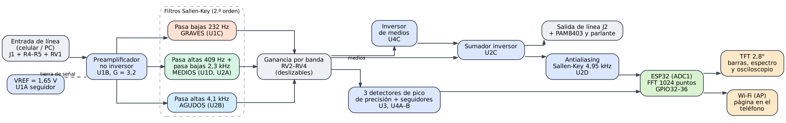

**Ilustración 1.** Diagrama de bloques. Fuente: elaboración propia en Graphviz.

La señal estéreo de la entrada de línea se mezcla a mono, pasa por el control de nivel y por el
preamplificador, y se reparte entre los tres filtros. Cada banda pasa por su deslizable y se suma
en U2C; la banda de medios se invierte antes (U4C). La salida ecualizada va al jack de salida, al
amplificador del parlante y, a través del filtro antialiasing, al ADC del ESP32 para la FFT. Del
cursor de cada deslizable salen también los detectores de pico, que el ESP32 lee como tensiones
casi continuas.

**Tabla 3.** Uso de los 16 amplificadores operacionales.

| CI | Unidad A | Unidad B | Unidad C | Unidad D |
|---|---|---|---|---|
| U1 | Seguidor de VREF | Preamplificador | Pasa bajas de graves | Pasa altas de medios |
| U2 | Pasa bajas de medios | Pasa altas de agudos | Sumador inversor | Antialiasing |
| U3 | Detector de graves | Seguidor de graves | Detector de medios | Seguidor de medios |
| U4 | Detector de agudos | Seguidor de agudos | Inversor de medios | Libre (seguidor de VREF) |

### 7.2. Esquemático

El esquemático se diseñó en **KiCad 9** ([`hardware/ecualizador.kicad_sch`](hardware/ecualizador.kicad_sch),
PDF en [`hardware/ecualizador.pdf`](hardware/ecualizador.pdf)). La verificación eléctrica termina
con **0 errores y 0 advertencias** ([`hardware/erc.rpt`](hardware/erc.rpt)), y
[`herramientas/verificar_netlist.py`](herramientas/verificar_netlist.py) comprueba que las 57 redes
de la netlist que exporta KiCad coinciden pin a pin con las de `circuito.py`, que es la misma
descripción que usan la simulación y la PCB.

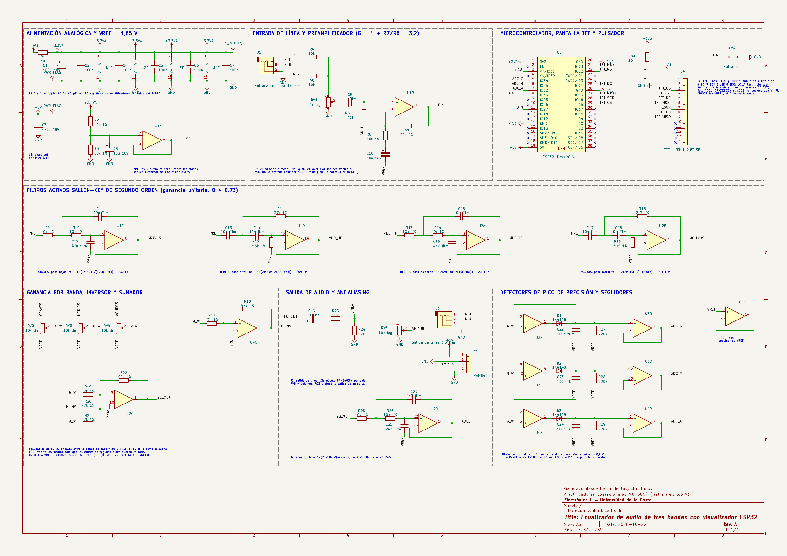

**Ilustración 2.** Esquemático completo (hoja A3). Las etapas con amplificador operacional se
dibujan con cables; las uniones entre etapas, con etiquetas de red. Fuente: elaboración propia en
KiCad 9.

### 7.3. Asignación de pines del ESP32

**Tabla 4.** Pines usados del ESP32-DevKitC V4.

| GPIO | Red | Función | Justificación |
|---|---|---|---|
| GPIO36 (VP) | `VREF` | ADC1_CH0: lee VREF | Se resta de los detectores; sigue las variaciones de 3,3 V |
| GPIO34 | `ADC_G` | ADC1_CH6: detector de graves | Solo entrada, ADC1 (funciona con Wi-Fi) |
| GPIO35 | `ADC_M` | ADC1_CH7: detector de medios | Solo entrada, ADC1 |
| GPIO32 | `ADC_A` | ADC1_CH4: detector de agudos | ADC1 |
| GPIO33 | `ADC_FFT` | ADC1_CH5: salida ecualizada para la FFT | ADC1 |
| GPIO23 / 19 / 18 | `TFT_MOSI` / `TFT_MISO` / `TFT_SCK` | SPI de la pantalla (VSPI) | Pines nativos del VSPI, 40 MHz |
| GPIO5 / 21 / 22 | `TFT_CS` / `TFT_DC` / `TFT_RST` | Control de la pantalla | Libres de funciones de arranque |
| GPIO27 | `BTN` | Pulsador de vista | Pull-up interno |
| 3V3 / 5V / GND | | Alimentación | 3V3 del regulador del DevKitC; 5V del USB para el PAM8403 |

### 7.4. Cálculos de diseño

**Tabla 5.** Valores y resultados calculados (fórmulas de la sección 4).

| Etapa | Componentes | Cálculo | Resultado |
|---|---|---|---|
| Filtro de alimentación | R1 = 10 Ω, C1 = 100 µF | 1/(2π·10·100 µ) | fc = 159 Hz; caída de 16 mV con 1,6 mA |
| VREF | R2 = R3 = 10 kΩ, C8 = 10 µF | 3,3 V / 2; 1/(2π·5 k·10 µ) | 1,65 V; ruido filtrado sobre 3,2 Hz |
| Mezcla a mono | R4 = R5 = 10 kΩ | Promedio de L y R | Impedancia de 5 kΩ hacia RV1 |
| Acople de entrada | C9 = 1 µF, R6 = 100 kΩ | 1/(2π·100 k·1 µ) | fc = 1,6 Hz |
| Preamplificador | R7 = 22 kΩ, R8 = 10 kΩ, C10 = 10 µF | 1 + 22/10; 1/(2π·10 k·10 µ) | G = 3,2 (10,1 dB); polo de C10 en 1,6 Hz |
| Graves (pasa bajas) | R = 10 kΩ, C11 = 100 nF, C12 = 47 nF | 1/(2π·10 k·√(100 n·47 n)) | fc = 232 Hz; Q = 0,73 |
| Medios (pasa altas) | C = 10 nF, R11 = 27 kΩ, R12 = 56 kΩ | 1/(2π·10 n·√(27 k·56 k)) | fc = 409 Hz; Q = 0,72 |
| Medios (pasa bajas) | R = 10 kΩ, C15 = 10 nF, C16 = 4,7 nF | 1/(2π·10 k·√(10 n·4,7 n)) | fc = 2,32 kHz; Q = 0,73; centro ≈ 970 Hz |
| Agudos (pasa altas) | C = 10 nF, R15 = 2,7 kΩ, R16 = 5,6 kΩ | 1/(2π·10 n·√(2,7 k·5,6 k)) | fc = 4,09 kHz; Q = 0,72 |
| Ganancia por banda | RV2–RV4 = 10 kΩ; R19–R21 = 47 kΩ; R22 = 100 kΩ | (100/47)·α | ≈ 1 (0 dB) al 50 %; ≈ +6 dB al 100 % |
| Inversor de medios | R17 = R18 = 47 kΩ | −47 k/47 k | −1 |
| Antialiasing | R = 10 kΩ, C20 = 4,7 nF, C21 = 2,2 nF | 1/(2π·10 k·√(4,7 n·2,2 n)) | fc = 4,95 kHz; Q = 0,73; −19 dB a 15 kHz |
| Detector de pico | Ch = 100 nF, Rd = 220 kΩ | Rd·Ch | τ = 22 ms |
| Salida | C19 = 10 µF, R23 = 100 Ω, R24 = 47 kΩ | 1/(2π·(100 + 10 k)·10 µ) con RV5 de carga | fc ≈ 1,6 Hz; R23 protege contra cortocircuitos |
| Margen del ADC | Pico ≤ 0,8 V sobre VREF | 0,8 V / (3,2 · 2,13) | Entrada ≤ 0,11 V de pico con todo al máximo; ≤ 0,23 V con los deslizables al 50 % |

**Cambios respecto a la Fase 1.**

1. **Ganancia del preamplificador:** la Fase 1 usaba 10,2 (R8 = 2,4 kΩ), pensada para un
   micrófono. Con la salida de un celular (0,3 a 1 V de pico) eso satura las etapas de 3,3 V. Se
   bajó a 3,2 (R8 = 10 kΩ) y se agregó el control de nivel RV1 a la entrada.
2. **Banda de medios invertida y nuevos cortes:** la simulación mostró que con los valores de la
   Fase 1 la suma tenía huecos de −11 dB en los cruces (sección 7.5). Se agregó el inversor U4C y se
   ajustaron los cortes de medios a 409 Hz y 2,32 kHz (R11 = 27 kΩ, R12 = 56 kΩ, C16 = 4,7 nF).
3. **Analizador de espectro:** se agregaron el filtro antialiasing (U2D) y la lectura de la salida
   ecualizada por GPIO33, tomados de la Propuesta 1.
4. **Salida de audio:** salida de línea J2 y conector J3 para el módulo PAM8403 con su parlante y el
   control de volumen RV5.

### 7.5. Simulación del circuito

La cadena analógica completa se simuló en **ngspice** con
[`herramientas/simulacion.py`](herramientas/simulacion.py). La netlist se arma desde `circuito.py`,
es decir, se simula exactamente el circuito del esquemático, y cada caso queda en la carpeta
[`simulacion/`](simulacion/) para abrirlo y repetirlo a mano. El MCP6004 se representa con un
macromodelo propio ([`simulacion/mcp6004.lib`](simulacion/mcp6004.lib)) con la ganancia, el GBW, la
rapidez de cambio y la salida riel a riel de la hoja de datos [6].

**Tabla 6.** Casos simulados y resultados ([`simulacion/resultados.md`](simulacion/resultados.md)).

| # | Caso | Resultado de la simulación | Criterio | Estado |
|---:|---|---|---|---|
| 1 | VREF en reposo | 1,6412 V | +3,3 VA / 2 ± 0,5 % | Cumple |
| 2 | Salidas en reposo (PRE, EQ_OUT, ADC_FFT) | 1,641 V, 1,641 V, 1,641 V | VREF ± 10 mV | Cumple |
| 3 | Detector de graves sin señal (ADC_G) | 1,641 V | VREF a VREF + 50 mV | Cumple |
| 4 | Alimentación analógica +3,3 VA (4 × MCP6004) | 3,282 V | ≥ 3,25 V | Cumple |
| 5 | Ganancia del preamplificador a 1 kHz | 3,20 (10,10 dB) | 3,2 ± 5 % | Cumple |
| 6 | Frecuencia de corte: graves, pasa bajas | 239 Hz | 232 Hz ± 10 % | Cumple |
| 7 | Frecuencia de corte: medios, pasa altas | 403 Hz | 409 Hz ± 10 % | Cumple |
| 8 | Frecuencia de corte: medios, pasa bajas | 2388 Hz | 2322 Hz ± 10 % | Cumple |
| 9 | Frecuencia de corte: agudos, pasa altas | 4026 Hz | 4093 Hz ± 10 % | Cumple |
| 10 | Frecuencia de corte: antialiasing | 5101 Hz | 4949 Hz ± 10 % | Cumple |
| 11 | Antialiasing: atenuación a 15 kHz | −19,3 dB | ≤ −15 dB | Cumple |
| 12 | Respuesta con los deslizables al 50 %, 20 Hz–20 kHz | −0,27 a +0,88 dB (rizado 1,16 dB) | rizado ≤ 1,5 dB | Cumple |
| 13 | Valores de la Fase 1 (sin inversor), deslizables al 50 % | −11,0 a +0,1 dB (rizado 11,1 dB) | rizado ≤ 1,5 dB | No cumple: motivó el rediseño |
| 14 | Rango de ajuste de graves en 60 Hz | +6,4 dB al 100 %, −5,7 dB al 25 % | ≥ +5 y ≤ −5 dB respecto al 50 % | Cumple |
| 15 | Rango de ajuste de medios en 1 kHz | +6,0 dB al 100 %, −5,1 dB al 25 % | ≥ +5 y ≤ −5 dB | Cumple |
| 16 | Rango de ajuste de agudos en 12 kHz | +6,3 dB al 100 %, −5,6 dB al 25 % | ≥ +5 y ≤ −5 dB | Cumple |
| 17 | Selectividad: tono de 100 Hz | G 255 mV · M 16 mV · A 0 mV | solo sube graves (≥ 4 veces las otras) | Cumple |
| 18 | Selectividad: tono de 1 kHz | G 15 mV · M 304 mV · A 17 mV | solo sube medios | Cumple |
| 19 | Selectividad: tono de 8 kHz | G 0 mV · M 12 mV · A 265 mV | solo sube agudos | Cumple |
| 20 | Linealidad del detector entre 0,1 y 0,5 V de pico | error máximo 2,0 % | ≤ 10 % | Cumple |
| 21 | Detector: tiempo de ataque (90 %) | 1,17 ms | ≤ 5 ms | Cumple |
| 22 | Detector: descarga 22 ms después del silencio | 36 % del pico | ≈ 37 % (τ = 22 ms) | Cumple |
| 23 | Entrada de 0,11 V de pico, deslizables al 100 %: ADC_M | 1,878 V | ≤ 2,45 V | Cumple |
| 24 | Ídem: ADC_FFT | 1,113 a 2,171 V | 0,15 a 2,45 V | Cumple |

Fuente: elaboración propia con ngspice.

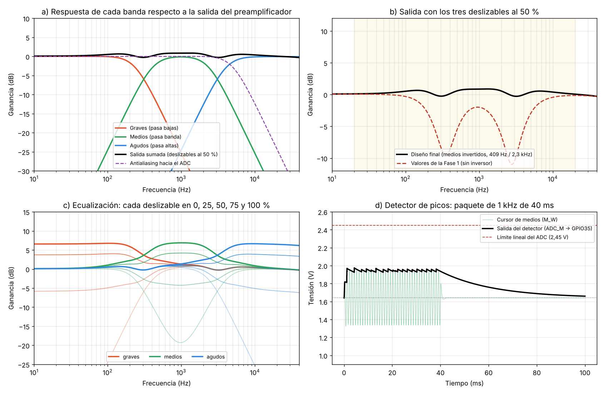

**Ilustración 3.** a) Respuesta de cada banda y de la salida sumada; b) suma con los deslizables al
50 %, con los valores finales y con los de la Fase 1; c) familia de curvas al mover cada deslizable;
d) detector de picos con un paquete de 1 kHz. Fuente: elaboración propia con ngspice y Matplotlib.

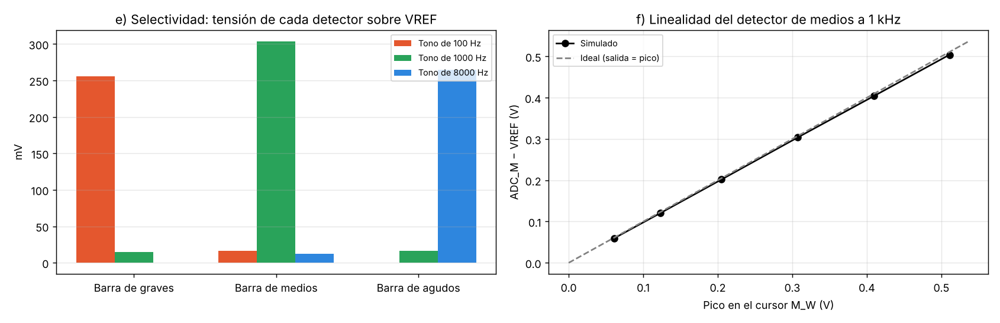

**Ilustración 4.** e) Tensión de cada detector con tonos de 100 Hz, 1 kHz y 8 kHz; f) linealidad
del detector de medios. Fuente: elaboración propia con ngspice y Matplotlib.

**Cambio de diseño a partir de la simulación.** Con los valores de la Fase 1, la suma de las tres
bandas con los deslizables al centro tenía dos huecos de unos −11 dB, cerca de 300 Hz y de 3 kHz
(fila 13 e Ilustración 3b). La causa es la de la sección 4.4: en cada cruce, la banda de medios y
su vecina llegan al sumador en contrafase y se cancelan. Con la banda de medios invertida (U4C) y
los cortes de medios llevados a 409 Hz y 2,32 kHz, la respuesta queda dentro de −0,3 a +0,9 dB entre
20 Hz y 20 kHz (fila 12). El amplificador que se usa estaba libre en U4, así que el cambio no
agregó integrados.

**Cómo mostrar la simulación en vivo.** Para la demostración desde el PC:

```bash
cd simulacion
ngspice ac_plano.cir          # dentro de ngspice: run, luego plot vdb(EQ_OUT)-vdb(PRE)
ngspice tran_tono_1000.cir    # plot v(ADC_G) v(ADC_M) v(ADC_A): solo sube la barra de medios
python3 ../herramientas/simulacion.py   # repite los 24 casos y regenera las gráficas
```

Las netlists también se abren en LTspice (File → Open, tipo `*.cir`), y el esquemático de KiCad 9
se puede simular con su simulador integrado (ngspice) asignando el modelo de
`simulacion/mcp6004.lib` a los MCP6004. Si el curso pide otro programa (Multisim, Proteus), basta
con dibujar cada etapa con los valores de la Tabla 5 y medir con el analizador de Bode y el
osciloscopio virtual los mismos casos de la Tabla 6.

> **Validación física pendiente.** Los resultados corresponden a los modelos descritos. Falta
> repetir en el montaje las pruebas de la sección 8 con el generador de funciones y el osciloscopio.

### 7.6. Placa de circuito impreso (PCB)

La PCB es de **dos capas, 200 × 120 mm**, con componentes de inserción para poder soldarla a mano, y
es a la vez el **panel del equipo**: la pantalla, los deslizables, las perillas y el pulsador
quedan por el lado superior, y los jacks y el USB del ESP32 salen por el borde derecho
([`hardware/ecualizador.kicad_pcb`](hardware/ecualizador.kicad_pcb)). Las huellas se ubican con
[`herramientas/generar_pcb.py`](herramientas/generar_pcb.py), que toma piezas y redes de la netlist
del esquemático, y el ruteo se hizo con **Freerouting**. Los planos de GND cubren las dos caras.

- 656 segmentos de pista (6,6 m) y 25 vías; pistas de 0,3 mm y separación de 0,25 mm.
- DRC con paridad contra el esquemático: **0 pads sin conectar y 0 diferencias con el esquemático**
  ([`hardware/drc.rpt`](hardware/drc.rpt)). Quedan 9 avisos no eléctricos: 5 textos de serigrafía
  que se tocan, 2 conexiones térmicas con solo 2 de 4 rayos al plano de GND inferior y 2 huellas de
  jack a las que se les quitó el recorte de panel que trae la biblioteca.
- La zona bajo la pantalla lleva solo piezas bajas (los detectores U3 y U4): la TFT queda 11 mm sobre
  la placa en su zócalo.
- Archivos de fabricación: Gerber y taladros en
  [`hardware/fabricacion/gerbers-ecualizador.zip`](hardware/fabricacion/gerbers-ecualizador.zip),
  lista de materiales de KiCad en [`hardware/fabricacion/bom.csv`](hardware/fabricacion/bom.csv).

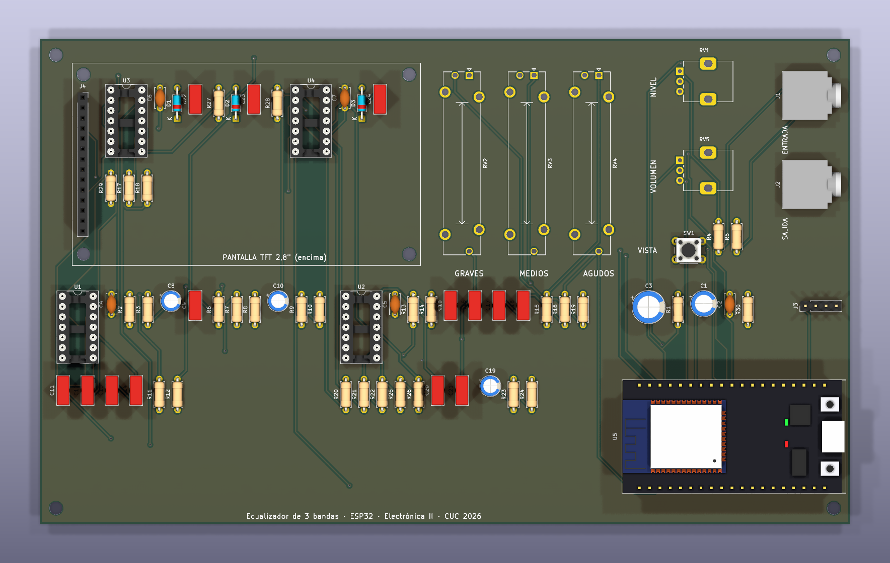

**Ilustración 5.** Vista superior de la PCB con sus modelos 3D. El rectángulo de serigrafía marca
dónde va la pantalla. Fuente: elaboración propia en KiCad 9.

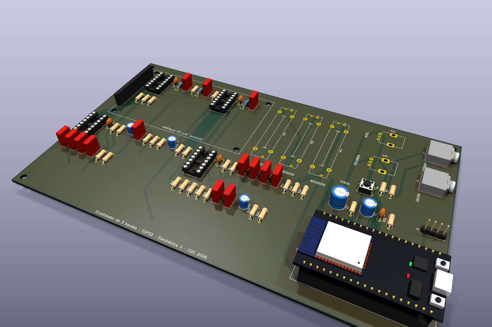

**Ilustración 6.** Modelo 3D de la PCB. Fuente: elaboración propia en KiCad 9.

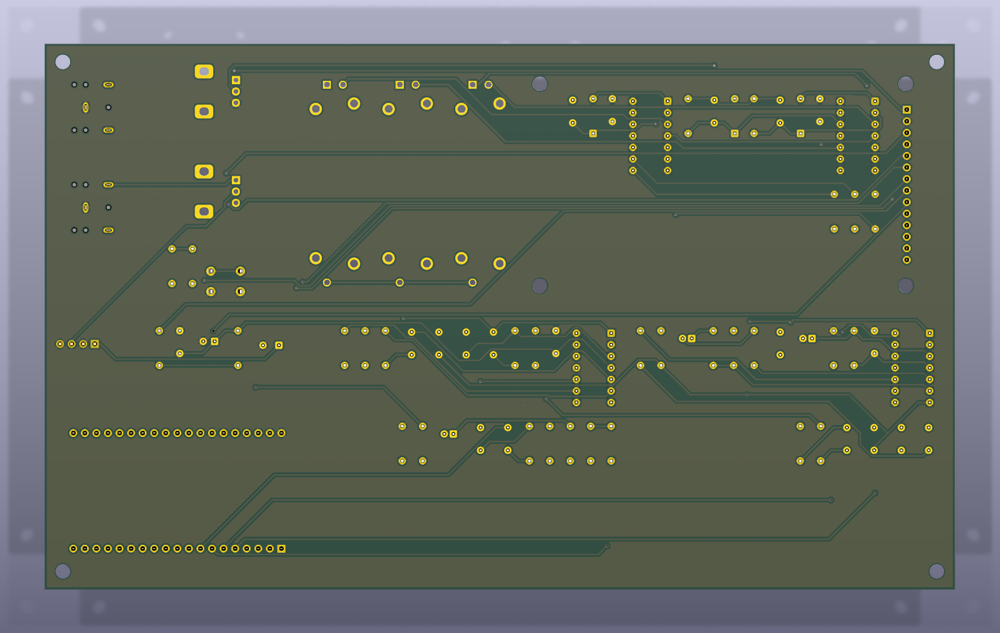

**Ilustración 7.** Cara inferior: ruteo y plano de GND. Fuente: elaboración propia en KiCad 9.

### 7.7. Montaje en protoboard

El prototipo se arma en dos protoboards de 830 puntos, en el orden de la señal, y se prueba etapa
por etapa antes de seguir con la siguiente. En protoboard van **todos los integrados, resistencias,
condensadores y diodos** y el ESP32 (62 de los 72 componentes del esquemático, el 86 %); fuera de ella quedan
los jacks, los potenciómetros y la pantalla, unidos con cables Dupont.

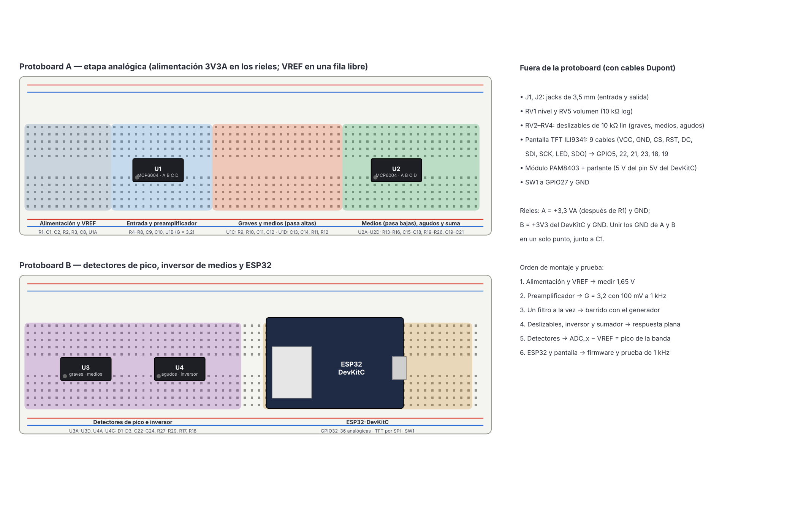

**Ilustración 8.** Distribución sugerida en las protoboards y orden de montaje. Fuente: elaboración
propia con Matplotlib.

**Tabla 7.** Pruebas por etapa durante el montaje.

| Paso | Etapa montada | Prueba | Valor esperado |
|---:|---|---|---|
| 1 | R1, C1, C2, divisor y U1A | Multímetro en VREF | 1,64–1,66 V |
| 2 | Entrada y preamplificador | 100 mV de pico a 1 kHz en J1, osciloscopio en PRE | 320 mV de pico centrados en VREF |
| 3 | Cada filtro | Barrido de 20 Hz a 20 kHz, medir el punto de −3 dB | Tabla 6, filas 6 a 9 (± 10 %) |
| 4 | Deslizables, inversor y sumador | Barrido con los deslizables al 50 % | Salida plana ± 1 dB |
| 5 | Detectores | Tonos de 100 Hz, 1 kHz y 8 kHz | Solo sube el detector de su banda |
| 6 | Antialiasing y ESP32 | Tono de 1 kHz, vista de espectro | Pico en 996 Hz (bin 51) |

Recomendaciones: alimentar la parte analógica solo desde el riel filtrado (+3,3 VA), unir las
tierras de las dos protoboards en un único punto junto a C1, mantener cortos los cables de los
filtros y poner los condensadores de desacople (C4–C7) pegados al pin 4 de cada MCP6004.

### 7.8. Prototipo: gabinete

El gabinete se modeló en **CadQuery** ([`cad/gabinete.py`](cad/gabinete.py)) en el mismo sistema de
coordenadas de la PCB, de modo que cada ranura y agujero de la tapa cae sobre su pieza; las
posiciones salen de [`hardware/3d/panel.json`](hardware/3d/panel.json), que escribe el generador de
la PCB. Se compone de:

- **Cuerpo** de 208 × 128 × 46,5 mm con paredes de 2,5 mm, cuatro postes de 26 mm que sostienen la
  PCB, la rejilla del parlante en el fondo y los pasos de los jacks y del USB en la pared derecha.
  Material: **PLA impreso en 3D** (blanco).
- **Tapa-panel** de 3 mm con la ventana de la pantalla, las tres ranuras de los deslizables con su
  escala, los agujeros de las perillas y del pulsador, y los textos grabados. Material: **acrílico
  negro de 3 mm cortado con láser** (o PLA gris oscuro impreso). Se atornilla a cuatro separadores
  de latón M3 × 16 mm que van de la PCB a la tapa.
- Perillas de aluminio, tapas de deslizable de caucho, parlante de 40 mm con el módulo PAM8403 en
  el fondo.

Las piezas se exportan en STL para imprimir ([`cad/stl/`](cad/stl/)) y el ensamble en STEP
([`cad/ecualizador-gabinete.step`](cad/ecualizador-gabinete.step)). Las vistas se renderizaron en
Blender con la PCB exportada de KiCad y la imagen real de la interfaz en la pantalla.

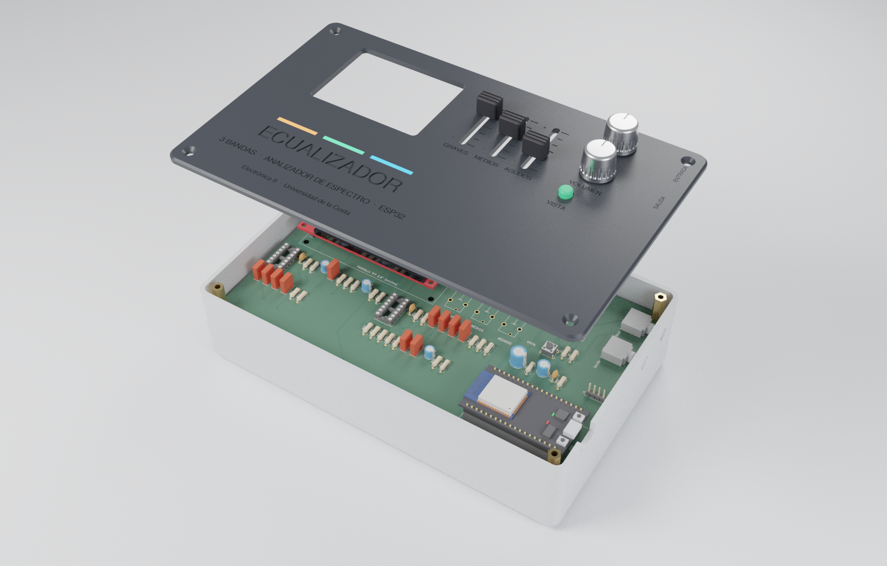

**Ilustración 9.** Vista con la tapa levantada: PCB con el ESP32, la pantalla en su zócalo y los
separadores. Fuente: elaboración propia en CadQuery, KiCad y Blender.

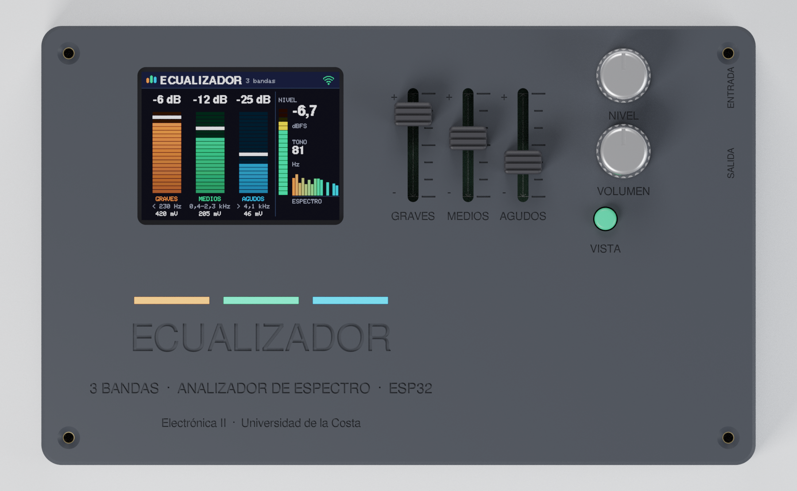

**Ilustración 10.** Vista superior del panel. Fuente: elaboración propia en CadQuery y Blender.

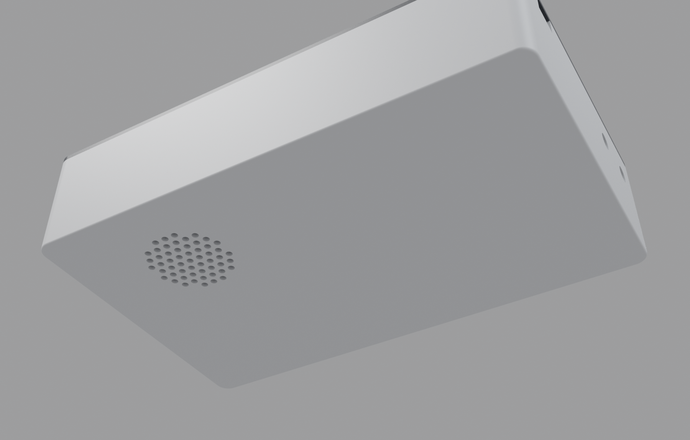

**Ilustración 11.** Fondo con la rejilla del parlante. Fuente: elaboración propia en CadQuery y
Blender.

### 7.9. Firmware

PlatformIO con el *framework* Arduino para ESP32 ([`firmware/`](firmware/)). Compila sin errores
(RAM 19,7 %, flash 62,8 %).

| Núcleo | Tarea | Qué hace |
|---|---|---|
| 0 | `adquisicion` | 1024 muestras de GPIO33 a 20 kS/s (51,2 ms), lectura promediada de los tres detectores y de VREF, FFT con ventana de Hann, 32 barras logarítmicas de 40 Hz a 5 kHz, nivel en dBFS, frecuencia dominante y aviso de recorte |
| 1 | `loop()` | Pantalla TFT por franjas de 320 × 40 píxeles (sin parpadeo y sin reservar 150 kB para un lienzo completo), retención de picos, pulsador y página web |

El procesamiento ([`firmware/lib/dsp/`](firmware/lib/dsp/)) y las pantallas
([`firmware/lib/interfaz/`](firmware/lib/interfaz/)) no dependen de Arduino y se prueban en el PC:

```bash
cd firmware
pio run -t upload        # compila y carga en el ESP32
make -C test prueba      # 19 pruebas del procesamiento con señales sintéticas
make -C test pantallas   # dibuja las pantallas en el PC (img/ui-tft-*.png)
```

Las pruebas en el PC pasan el tono por el mismo modelo del ADC (12 bits, ruido de ±2 LSB) y
comprueban, entre otras cosas, que un tono de 1 kHz cae en el bin 51 con 999 Hz interpolados y
−6,0 dBFS, que dos tonos separados 14 dB se ven separados 14 dB y que el aviso de recorte se
activa. Esas pruebas encontraron que por debajo de 300 Hz las barras logarítmicas eran más
angostas que un bin (19,5 Hz) y dos barras mostraban el mismo bin; las barras se definen ahora en
bins, con al menos uno por barra.

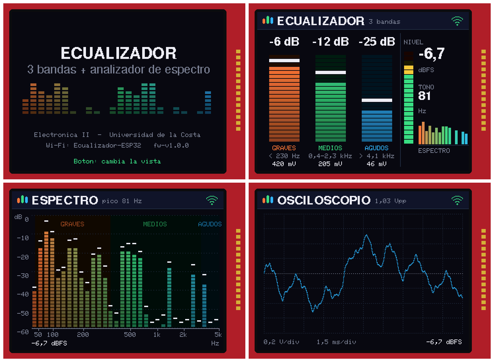

**Ilustración 12.** Pantallas de la TFT dibujadas con el mismo código del firmware: arranque,
bandas (barras de los detectores, nivel y tono dominante), espectro de 32 barras con retención de
picos y osciloscopio. El pulsador cambia de vista. Fuente: elaboración propia.

El ESP32 crea además la red Wi-Fi **Ecualizador-ESP32** (clave `electronica2`); en
`http://192.168.4.1` muestra las bandas y el espectro en el teléfono.

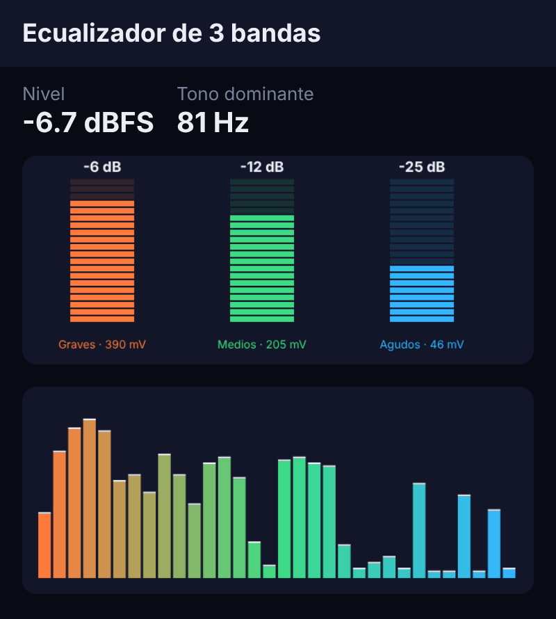

**Ilustración 13.** Página web servida por el ESP32. Fuente: elaboración propia.

## 8. Validación y criterios de aceptación

**Tabla 8.** Pruebas del prototipo (generador de funciones, osciloscopio y multímetro).

| Prueba | Procedimiento | Criterio de aceptación |
|---|---|---|
| Frecuencias de corte | Barrido de cada filtro | ± 10 % de la Tabla 5 |
| Respuesta plana | Deslizables al 50 %, barrido de 20 Hz a 20 kHz | Rizado ≤ 1,5 dB |
| Rango de ecualización | Cada deslizable al 0, 50 y 100 % | ≥ ± 5 dB en el centro de su banda |
| Selectividad | Tonos de 100 Hz, 1 kHz y 8 kHz | Solo se enciende la barra de su banda |
| Independencia | Mover un deslizable | Cambia su barra y no las demás |
| Linealidad del detector | 0,1 a 0,5 V de pico en el cursor | ADC_x − VREF proporcional, error ≤ 10 % |
| Espectro | Tono de 1 kHz | Pico en 996 Hz (bin 51) |
| Refresco de la pantalla | Contar imágenes por segundo por la consola serie | ≥ 5 imágenes/s |

## 9. Referencias

[1] A. S. Sedra y K. C. Smith, *Microelectronic Circuits*, 7.ª ed. Oxford University Press, 2015.

[2] S. Franco, *Design with Operational Amplifiers and Analog Integrated Circuits*, 4.ª ed.
McGraw-Hill Education, 2015.

[3] P. Horowitz y W. Hill, *The Art of Electronics*, 3.ª ed. Cambridge University Press, 2015.

[4] J. Karki, "Analysis of the Sallen-Key Architecture," Texas Instruments, Application Report
SLOA024B, 2002.

[5] B. Carter y R. Mancini, *Op Amps for Everyone*, 3.ª ed. Newnes, 2009.

[6] Microchip Technology, "MCP6001/1R/1U/2/4: 1 MHz, Low-Power Op Amp," hoja de datos DS20001733.

[7] S. H. Linkwitz, "Active Crossover Networks for Noncoincident Drivers," *Journal of the Audio
Engineering Society*, vol. 24, n.º 1, pp. 2–8, 1976.

[8] W. G. Jung, *Op Amp Applications Handbook*. Analog Devices / Newnes, 2005.

[9] A. V. Oppenheim y R. W. Schafer, *Discrete-Time Signal Processing*, 3.ª ed. Pearson, 2010.

[10] F. J. Harris, "On the Use of Windows for Harmonic Analysis with the Discrete Fourier
Transform," *Proceedings of the IEEE*, vol. 66, n.º 1, pp. 51–83, 1978.

[11] Espressif Systems, *ESP32 Technical Reference Manual* y *ESP-IDF Programming Guide: ADC*.
https://docs.espressif.com

[12] Behringer, "ULTRAGRAPH PRO FBQ1502HD," página del producto. https://www.behringer.com

[13] P. J. Baxandall, "Negative-Feedback Tone Control," *Wireless World*, pp. 402–405, oct. 1952.

[14] Mixed Signal Integration, "MSGEQ7 Seven Band Graphic Equalizer Display Filter," hoja de datos.

[15] WLED Project, "Audio Reactive," documentación. https://kno.wled.ge

[16] Analog Devices, "ADAU1701 SigmaDSP Digital Audio Processor," hoja de datos.

[17] J. Mulcahy, "Room EQ Wizard," documentación. https://www.roomeqwizard.com

[18] Ilitek, "ILI9341: a-Si TFT LCD Single Chip Driver 240RGBx320," hoja de datos.

[19] Diodes Incorporated, "PAM8403: Filterless 3 W Class-D Stereo Audio Amplifier," hoja de datos.

## 10. Anexo: archivos fuente y cómo regenerar todo

| Carpeta | Contenido |
|---|---|
| [`herramientas/`](herramientas/) | `circuito.py` (descripción única del circuito), `simulacion.py`, `generar_esquematico.py`, `verificar_netlist.py`, `generar_pcb.py`, `exportar_fabricacion.sh`, `lista_materiales.py`, `protoboard.py`, `diagrama_bloques.dot` |
| [`simulacion/`](simulacion/) | Netlists de ngspice de cada caso, macromodelo del MCP6004 y tabla de resultados |
| [`hardware/`](hardware/) | Proyecto de KiCad 9 (esquemático, PCB, biblioteca propia del DevKitC), informes ERC y DRC, fabricación |
| [`firmware/`](firmware/) | Proyecto de PlatformIO, procesamiento, pantallas, página web y pruebas en el PC |
| [`cad/`](cad/) | Gabinete en CadQuery, STL, STEP y render en Blender |
| [`img/`](img/) | Ilustraciones del documento |

Herramientas: KiCad 9, ngspice 42, Python 3 (matplotlib, numpy, CadQuery), Freerouting 2.1,
PlatformIO, Blender 4 y Graphviz.

```bash
cd herramientas
python3 simulacion.py                 # 24 casos de simulación y gráficas
python3 generar_esquematico.py        # esquemático de KiCad
python3 verificar_netlist.py          # netlist de KiCad = circuito.py
python3 generar_pcb.py                # ubica, rutea (Freerouting) y rellena planos
./exportar_fabricacion.sh             # Gerber, taladros, PDF, BOM, ERC y DRC
python3 protoboard.py                 # guía de protoboard
dot -Tpng -Gdpi=150 diagrama_bloques.dot -o ../img/diagrama-de-bloques.png
cd ../cad && ./generar.sh             # gabinete y renders
```
