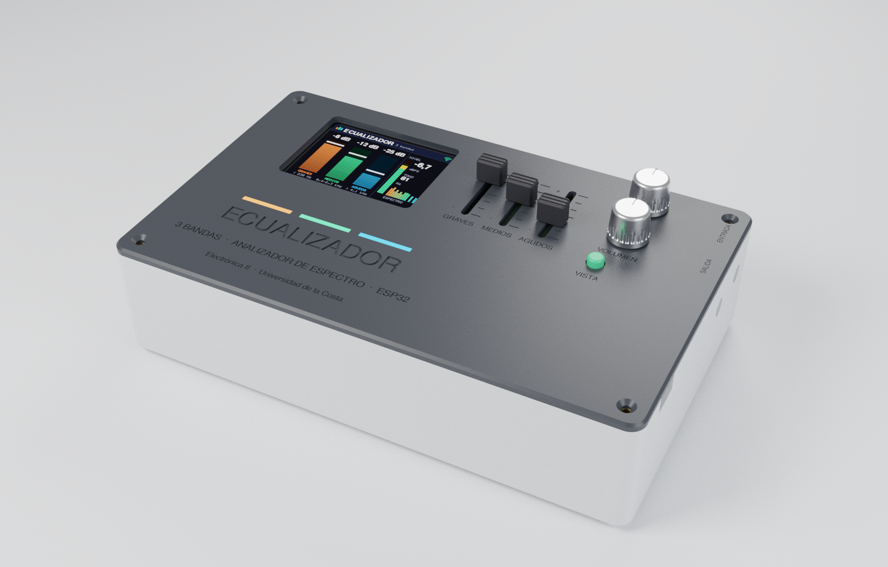
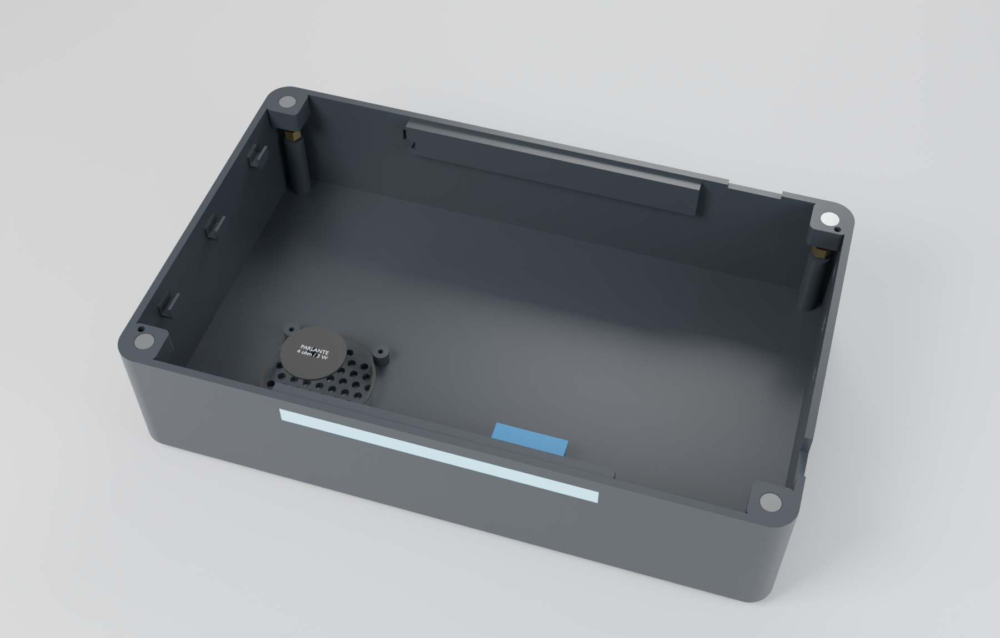

# Ecualizador de audio de tres bandas con ESP32

## Prototipo en protoboard

[Guía de montaje y esquema (PDF)](docs/protoboard/guia-prototipo-protoboard.pdf) · [Lista de materiales (CSV)](docs/protoboard/materiales.csv) · [Conexiones pin por pin (CSV)](docs/protoboard/conexiones.csv). Incluye pruebas con generador y osciloscopio, y ampliación con ESP32, pantalla y NeoPixel. [Fuente LaTeX](docs/latex/prototipo-protoboard.tex).


## Video del dispositivo

[Ver video en Full HD](docs/video/ecualizador-animado.mp4) · [Escena de Blender y texturas](docs/video/ecualizador-blender.zip). Demo de 36 segundos con sonido: los deslizadores cambian el audio usando las respuestas SPICE del circuito. Pantalla y luces sincronizadas; apertura de la tapa imantada. Es una demo virtual, no una grabación del prototipo físico.


Proyecto de Electrónica II · Universidad de la Costa · Leo Rojas, David Orozco y Manuel Castilla.

La ruta de audio usa filtros activos y controles analógicos. El ESP32 lee los niveles y calcula una FFT para la pantalla Waveshare de **1,9 pulgadas, 170 × 320, ST7789V2**. El gabinete EQ / 03 tiene acabado grafito, cierre con cuatro pares de imanes y dos canales interiores para 12 NeoPixel.

| Entrega | Archivos actuales |
|---|---|
| Presentación en LaTeX | [PDF](docs/presentacion/presentacion-fase2.pdf) · [PowerPoint con notas](docs/presentacion/presentacion-fase2.pptx) · [PDF con notas](docs/presentacion/presentacion-notas.pdf) |
| Exposición con animaciones | [PowerPoint animado](docs/presentacion/presentacion-animada.pptx) · [PDF por pasos](docs/presentacion/presentacion-animada.pdf) · [Cómo presentar](docs/presentacion/LEEME.md) |
| Informe | [PDF](docs/informe-fase2.pdf) · [Word](docs/informe-fase2.docx) · [Markdown](docs/informe-fase2.md) |
| Fuentes editables en LaTeX | [Informe](docs/latex/informe.tex) · [Presentación Beamer](docs/latex/presentacion.tex) |
| Presentación corta de filtros | [PDF de 10 diapositivas](docs/presentacion/presentacion-filtros-hoy.pdf) · [PowerPoint con notas](docs/presentacion/presentacion-filtros-hoy.pptx) · [Fuente LaTeX](docs/latex/presentacion-filtros.tex) |
| Ensayo de hoy | [Generador y osciloscopio: guía](simulacion/velxio/DEMO-HOY.md) |
| Paquete para otro computador | [ZIP portátil: presentación, esquema y simulaciones](docs/exposicion-portable.zip) |
| Simulación en Velxio | [Abrir casos locales](simulacion/velxio/index.html) · [Instrucciones y alcance](simulacion/velxio/README.md) · [100 Hz](simulacion/velxio/filtros-100Hz.vlx) · [1 kHz](simulacion/velxio/filtros-1000Hz.vlx) · [8 kHz](simulacion/velxio/filtros-8000Hz.vlx) |
| Proyecto único E.4-LM324 | [Abrir en KiCad](hardware/E4-LM324/proyecto/ecualizador-E4-LM324.kicad_pro) · [Esquema PDF](hardware/E4-LM324/proyecto/ecualizador-E4-LM324.pdf) · [Fabricación](hardware/E4-LM324/fabricacion/) · [Vista superior](hardware/E4-LM324/vistas/3d-top.png) · [Vista inferior](hardware/E4-LM324/vistas/3d-bottom.png) · [Montaje](hardware/E4-LM324/README.md) |
| Prototipo modular E.5 en tarjetas perforadas | [Esquema modular PDF](hardware/E5-perforadas/esquema-modular-perforadas.pdf) · [Proyecto KiCad](hardware/E5-perforadas/proyecto/ecualizador-perforadas.kicad_pro) · [Conexiones](hardware/E5-perforadas/conexiones-entre-tarjetas.csv) · [Modelo 3D editable](hardware/E5-perforadas/3d/ecualizador-E5-perforadas.FCStd) · [Vista abierta](hardware/E5-perforadas/3d/ecualizador-E5-abierto.png) · [Guía](hardware/E5-perforadas/README.md) |
| PCB E.3-LM324 de una cara | [KiCad](hardware/E3-LM324/placa/ecualizador-E3-LM324.kicad_pcb) · [Fabricación](hardware/E3-LM324/fabricacion/) · [Vista superior](hardware/E3-LM324/vistas/3d-top.png) · [Vista inferior](hardware/E3-LM324/vistas/3d-bottom.png) · [Reglas y montaje](hardware/E3-LM324/README.md) |
| PCB de una cara D.2 (anterior, MCP6004) | [Plano PDF](hardware/pcb-rev-D2.pdf) · [KiCad](hardware/ecualizador.kicad_pcb) · [DRC](hardware/drc.rpt) · [Montaje y puentes](hardware/una-cara/LEEME.md) · [BOM](hardware/fabricacion/bom.csv) |
| Modelos 3D | [Gabinete STEP](cad/ecualizador-gabinete.step) · [Piezas STL](cad/stl/) · [Retrofit D.3 STEP](hardware/3d/ecualizador-D3-retrofit.step) · [Vista superior](hardware/3d/ecualizador-D3-retrofit.png) · [Vista inferior](hardware/3d/ecualizador-D3-retrofit-inferior.png) · [PCB D.2 STEP](hardware/3d/ecualizador-placa.step) |
| Propuesta original y rúbrica | [Fase 1](docs/fase1/) |



## Estado de la revisión del 5 de noviembre de 2026

- E.4-LM324 es la fuente única de fabricación: esquema físico y PCB en el mismo proyecto, paridad estricta KiCad con 0 diferencias, ERC con 0 errores y DRC con 0 errores/0 conexiones abiertas. Los 23 avisos ERC son exclusivamente pines `NC-*` intencionales.
- D.3 usa cuatro LM324N a 5 V, conserva VREF en 1,65 V y protege las cuatro entradas ADC con atenuadores 2:1 referidos a VREF. El firmware reconstruye la amplitud original.
- ngspice: 25 casos del diseño revisado cumplen; el caso histórico de Fase 1 se conserva deliberadamente como no conforme. El modelo funcional del LM324 valida margen de modo común, dinámica y protección ADC, pero no sustituye mediciones físicas.
- La PCB D.2 archivada conserva el ruteo y BOM del MCP6004 a 3,3 V. No coincide directamente con D.3: para reutilizarla se debe seguir la [adaptación LM324](hardware/RETROFIT-LM324.md). No enviar D.2 a fabricar como si ya incorporara R33–R40.
- La nueva PCB [E.3-LM324](hardware/E3-LM324/README.md) incorpora LM324 a 5 V y R33–R40: una cara, 23 alambres, pistas de 0,7 mm o más, donas de 1,9 mm o más y ninguna pista de paso entre pines a 2,54 mm. DRC sin errores ni conexiones abiertas; montaje físico pendiente.
- E.4 sustituye a E.3 como opción recomendada para soldadura manual: pads de componentes ovalados de al menos 2,4 × 2,0 mm, pads propios de puente de 2,4 mm, 25 alambres de hasta 30,9 mm, alimentación +5 V perimetral y ningún puente reutiliza un agujero de componente.
- Velxio: tres proyectos ejecutados con motor SPICE; predominan graves a 100 Hz, medios a 1 kHz y agudos a 8 kHz. Los filtros usan operacionales ideales. Un cuarto [ensayo animado de 12 NeoPixel](simulacion/velxio/led-animado.vlx) ejecuta código del ESP32; usa un patrón programado sin audio.
- Velxio integrado: entrada → filtros → detectores → ADC ESP32 → TFT ILI9341, usando QEMU. Se comprueba el predominio de cada banda con 100 Hz, 1 kHz y 8 kHz. FFT sin calibración de frecuencia; no incluye potencia ni adaptación LED. [Guía y modelos](simulacion/velxio/INTEGRADO.md).
- Firmware: compilación ESP32 correcta; 19 comprobaciones DSP y cinco comparaciones de dibujo por franjas correctas en el computador.
- El montaje físico, las mediciones con instrumentos y el requisito de más del 70 % de dispositivos adquiridos y conectados **siguen sin evidencia en este repositorio**.

Los [resultados ngspice vigentes](simulacion/resultados.md) corresponden a D.3-LM324; `docs/validacion/` conserva registros históricos de D.2. Los renders provienen del CAD y de KiCad; las pantallas se dibujan con el código de interfaz y datos de ejemplo.

## Pantalla e iluminación

J4 es un adaptador de ocho señales a 2,54 mm, no la huella GH1.25 de Waveshare. Conectar por **nombre de señal**, siguiendo la tabla del informe: VCC, GND, DIN, CLK, CS, DC, RST y BL. La interfaz trabaja en horizontal a 320 × 170.

GPIO25 controla la tira mediante un 74AHCT125 y 330 Ω. J5 lleva 5 V, DIN y GND. Se prevén dos tramos de 100 mm, seis LED por tramo, y canales de 102 × 10,6 × 3 mm con difusores. El brillo inicial es 32/255, fijo. La fuente prevista es de 5 V / 3 A por J6; **desconectar VBUS del USB cuando se usa esa fuente**. No alimentar los LED desde 3,3 V ni usar VREF como retorno.



## Reproducir los archivos

Los PDF usan el logo oficial CUC, rojo institucional y Red Hat Display, según el [manual consultado](img/marca/README.md). Las fuentes vigentes son los `.tex` (LuaLaTeX). El PowerPoint contiene imágenes de las diapositivas y notas; el texto se edita en LaTeX. El HTML anterior está archivado en `docs/archivo/`.

```sh
# TeX Live: latex-extra, lang-spanish, fonts-recommended, luatex; pandoc
# Python: pymupdf, python-pptx (para exportar PNG y PowerPoint)
bash herramientas/compilar_documentos.sh

# Firmware y pruebas en computador
pio run -d firmware
make -C firmware/test prueba pantallas

# Conectividad y simulación (ngspice, numpy, matplotlib)
python3 herramientas/verificar_netlist.py
.venv/bin/python herramientas/simulacion.py

# PCB de una cara: regenerar el esquema físico E.4 y verificar
python3 herramientas/generar_esquematico_e4.py
kicad-cli pcb drc --schematic-parity hardware/E4-LM324/proyecto/ecualizador-E4-LM324.kicad_pcb
python3 herramientas/validar_pcb_cnc.py hardware/E4-LM324/proyecto/ecualizador-E4-LM324.kicad_pcb 0.7 1.9

# CAD (CadQuery) y renders (Blender, KiCad)
.venv/bin/python herramientas/validar_cad.py
bash cad/generar.sh

# Repetir la comprobación web (Node y Playwright con Chromium)
node herramientas/validar_velxio.cjs
node herramientas/validar_led_velxio.cjs
```

Las vistas de ensamblaje y colores de bandas parten de C2-ABPR; la revisión EQ / 03 adopta acabado grafito, rotulación compacta y cierre magnético. Las cotas de pantalla, controles y conectores deben contrastarse con las piezas adquiridas antes de imprimir y montar.

La presentación incluye fragmentos del esquema real para explicar preamplificador, Sallen-Key, sumador y detector. Los PDF adjuntan el esquema, el plano D.2 y los proyectos Velxio. El enlace y el QR abren el editor; después se importa el caso `.vlx`. Ver [cierre magnético y cotas](cad/CIERRE-MAGNETICO.md).

La PCB D.2 organiza las etapas con el flujo Python/KiCad y Freerouting de medidor-energia-esp32: ESP32 a la derecha, operacionales por etapas y cableado identificado por colores. Usa una sola cara de cobre y puentes aislados. Los controles van en el panel y requieren las [cabeceras y cables de montaje](hardware/una-cara/LEEME.md). Los Gerbers de dos capas B.1 están archivados y no corresponden al montaje vigente.

### Placa única E.2 (propuesta, 33 alambres)

[E.2](hardware/E2-placa-unica/README.md) reduce los 80 tramos de D.2 a 33 alambres en una sola placa de una cara de 200 × 120 mm para el gabinete original. Usa plano de GND, componentes con las patas más abiertas para pasar pistas por debajo, y reasigna las secciones de los amplificadores y los GPIO. El firmware se compila con `pio run -e e2`. La alternativa de tres placas está en [E.1](hardware/E1-tres-placas/README.md).

### Montaje de los puentes

La cara superior lleva 29 puentes cortos (hasta 20 mm entre extremos). Los 51 cables restantes se montan aislados por debajo. El total sigue siendo 80 tramos; no se añade una capa de cobre. [La guía](hardware/PUENTES.md) y [el plano de cuatro páginas](hardware/pcb-rev-D2.pdf) indican la cara de cada conexión. Los arcos del render son orientativos: el montaje requiere comprobar separación, sujeción y continuidad.

### Prototipo de laboratorio con TL072CP (±12 V)

Para el montaje con los integrados disponibles: [guía PDF](docs/prototipo-tl072/guia-prototipo-TL072.pdf), [fuente LaTeX](docs/latex/prototipo-tl072.tex) y [paquete de conexiones y simulación](docs/prototipo-tl072/prototipo-TL072.zip). Utiliza cuatro TL072, salida de línea y medidas a 100 Hz, 1 kHz y 8 kHz. Es una variante analógica independiente del diseño MCP6004 de 3,3 V; sus salidas no se conectan directamente al ESP32.

Esquema completo del prototipo en una lámina A2: [PDF](docs/prototipo-tl072/esquema-completo-TL072.pdf) · [SVG editable](docs/prototipo-tl072/esquema-completo.svg). Incluido al final de la guía TL072.
