

------------------------------------------------------------------------

**ELECTRÓNICA II / PROYECTO DE AULA / FASE 2**

**Ecualizador de audio**

de tres bandas

Analizador de espectro en ESP32

Diseño del gabinete con pantalla Waveshare y canales NeoPixel. Render
CAD.

Leo Rojas · David Orozco · Manuel Castilla

Ingeniería Electrónica · Universidad de la Costa

Barranquilla · 22 de octubre de 2026

------------------------------------------------------------------------

**Alcance de esta entrega.** Se presentan el diseño, las simulaciones,
la PCB, el gabinete y el firmware. Los resultados numéricos corresponden
a simulaciones y pruebas en computador.

# Introducción y elección de la propuesta

El ecualizador permite ajustar graves, medios y agudos de una señal de
línea. La cadena analógica tiene puntos de medida entre etapas para
comparar su respuesta con los cálculos y las simulaciones. El audio de
línea se mezcla a mono, se acondiciona alrededor de una referencia de
tensión, se separa con filtros activos y se vuelve a sumar después de
ajustar cada banda.

El ESP32 se utiliza para observar esa cadena: lee tres detectores de
pico y calcula el espectro de la salida. La ecualización ocurre en los
amplificadores operacionales; la pantalla y el enlace Wi-Fi muestran las
medidas. Esto permite comparar el sonido, las señales del osciloscopio y
la respuesta calculada.

En la Fase 1 se plantearon un preamplificador con analizador, un
ecualizador de tres bandas y un monitor de ECG. Se escogió el
ecualizador porque permite trabajar con realimentación, filtros, suma de
señales y detección de picos en un mismo circuito. Se incorporó el
análisis espectral de la primera propuesta. El documento original se
conserva en `docs/fase1/Propuestas_Electronica_II.pdf`.

La pantalla es una Waveshare de 1,9 pulgadas, 170 × 320 píxeles y
controlador ST7789V2. Dos tramos de tira NeoPixel iluminan el interior
de la caja y reciben alimentación de 5 V.

# Objetivos

## Objetivo general

Desarrollar un ecualizador de audio de tres bandas que permita ajustar
graves, medios y agudos, reproducir la señal procesada y visualizar sus
niveles y espectro mediante un ESP32.

## Objetivos específicos

1.  Diseñar los filtros activos y las etapas de ajuste y suma para
    controlar las tres bandas de audio.

2.  Integrar la salida de línea, el amplificador y los controles en un
    equipo con PCB de una cara y gabinete propio.

3.  Programar la adquisición y visualización con el ESP32, y evaluar el
    equipo mediante simulación y mediciones de laboratorio.

# Estado del arte

Los filtros Sallen-Key, el procesamiento digital con ADAU1701 y WLED
Audio Reactive ofrecen referencias para el filtrado y la visualización.
En este proyecto se conservan los filtros analógicos para medir sus
nodos en el laboratorio.

| Antecedente             | Qué aporta                                                                                      | Relación con el proyecto                                                                                                                   |
|:------------------------|:------------------------------------------------------------------------------------------------|:-------------------------------------------------------------------------------------------------------------------------------------------|
| Filtros Sallen-Key      | Implementación activa con un operacional por sección de segundo orden.                          | Sus relaciones entre $R$, $C$, frecuencia y amortiguamiento sirven para dimensionar las bandas.                                            |
| ADAU1701 y SigmaStudio  | Procesamiento digital programable; incorpora dos ADC y cuatro DAC.                              | Es una alternativa para ecualización flexible. Aquí se conservan filtros analógicos para medir sus nodos.                                  |
| WLED Audio Reactive     | Análisis de audio para efectos LED; admite micrófonos y distintas opciones de entrada de línea. | Es una referencia de visualización con ESP32. La iluminación de esta entrega es fija y tenue; no se presenta como un analizador adicional. |

Comparación basada en documentación de los fabricantes y del proyecto
WLED.

La decisión de diseño es mantener separadas la ruta de audio y la ruta
de observación. Una falla del enlace Wi-Fi no necesita interrumpir el
filtrado analógico. A cambio, la precisión del análisis queda limitada
por el ADC interno, el filtro previo y la temporización del muestreo.

# Marco teórico y cálculos

## Alimentación única y referencia de señal

<figure>
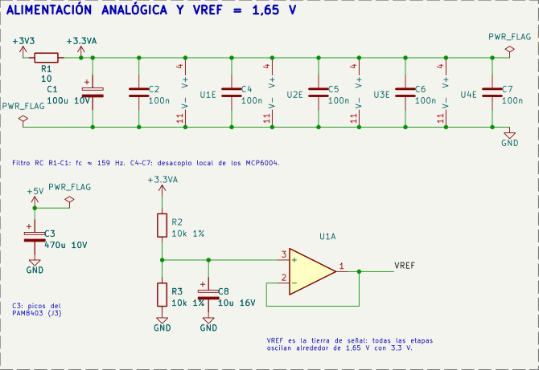
<figcaption>Alimentación analógica y referencia VREF con
U1A.</figcaption>
</figure>

La señal de audio cambia de polaridad, mientras que los MCP6004 trabajan
entre GND y la alimentación analógica. Las unidades U1E–U4E muestran los
pines de alimentación de los MCP6004: pin 4 a la alimentación y pin 11 a
GND. C4–C7 son condensadores de desacoplo de 100 nF. PWR_FLAG es una
indicación de alimentación para la comprobación ERC de KiCad, no un
componente físico. R2 y R3 forman un divisor; U1A lo sigue para producir
$V_{REF}\simeq V_{3.3VA}/2$. Así, cada etapa procesa una señal centrada
cerca de 1,65 V. VREF es una referencia de señal: no debe usarse como
retorno del parlante o de los LED.

El MCP6004 tiene un producto ganancia–ancho de banda típico de 1 MHz y
funciona con alimentación entre 1,8 y 6 V . La capacidad de acercarse a
los rieles depende de la carga. El modelo utilizado no caracteriza
ruido, distorsión ni tolerancias de fabricación.

## Preamplificador y entrada

<figure>
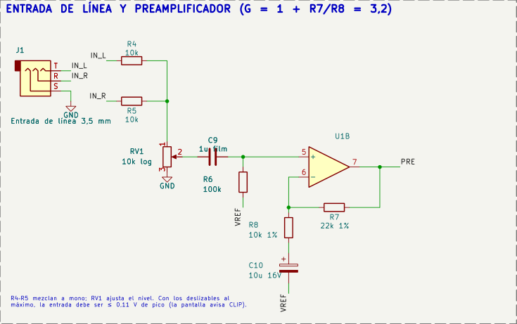
<figcaption>Entrada y preamplificador: fragmento del esquema
D.2.</figcaption>
</figure>

R4 y R5 mezclan los canales estéreo sin cortocircuitarlos entre sí. RV1
ajusta el nivel y C9 elimina la componente continua de la fuente. La
ganancia desde PRE_IN hasta PRE, en la banda de paso, es
$$A_v=1+\frac{R_7}{R_8}=1+\frac{22\,\mathrm{k}\Omega}{10\,\mathrm{k}\Omega}=3,2.$$
C10 limita la ganancia en continua a uno. El valor 3,2 no representa la
ganancia desde el jack: la mezcla y RV1 atenúan antes del amplificador.
Por eso, al medir esta etapa se comparan PRE_IN y PRE.

## Filtros Sallen-Key

<figure>
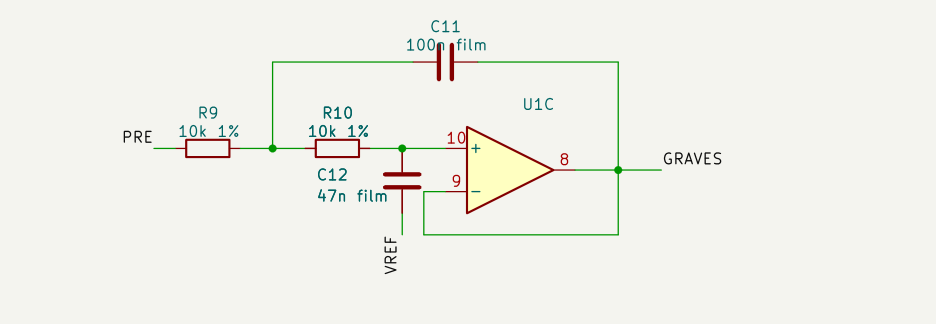
<figcaption>Pasa bajas de graves: C11 realimenta desde la salida de U1C;
C12 se conecta a VREF.</figcaption>
</figure>

Para el pasa bajas de ganancia unitaria, con dos resistencias iguales, y
para el pasa altas, con dos condensadores iguales, se obtiene :
$$\begin{aligned}
 f_{0,PB}&=\frac{1}{2\pi R\sqrt{C_1C_2}}, & Q_{PB}&=\frac12\sqrt{\frac{C_1}{C_2}},\\
 f_{0,PA}&=\frac{1}{2\pi C\sqrt{R_1R_2}}, & Q_{PA}&=\frac12\sqrt{\frac{R_2}{R_1}}.
\end{aligned}$$ $f_0$ es la frecuencia natural. Solo coincide
exactamente con el corte a $-3$ dB cuando $Q=1/\sqrt2$. Los valores
comerciales elegidos dan $Q$ cercano a 0,73, de modo que se espera una
pequeña diferencia entre cálculo y corte simulado.

| Sección              | $f_0$ calculada | Corte simulado |
|:---------------------|----------------:|---------------:|
| Graves, pasa bajas   |          232 Hz |         239 Hz |
| Medios, pasa altas   |          409 Hz |         403 Hz |
| Medios, pasa bajas   |         2322 Hz |        2388 Hz |
| Agudos, pasa altas   |         4093 Hz |        4026 Hz |
| Filtro antes del ADC |         4949 Hz |        5101 Hz |

<figure>
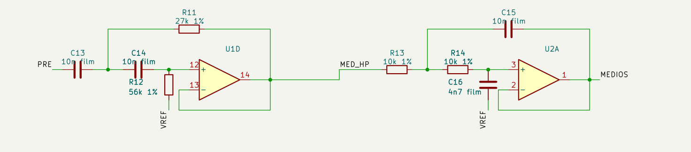
<figcaption>Banda de medios: la salida de U1D entra a U2A por
MED_HP.</figcaption>
</figure>

La banda de medios conecta un pasa altas de 403 Hz con un pasa bajas de
2388 Hz. La salida de U1D llega directamente a la entrada de U2A por la
red MED_HP. Cada sección es de segundo orden; la cascada es de cuarto
orden.

<figure>
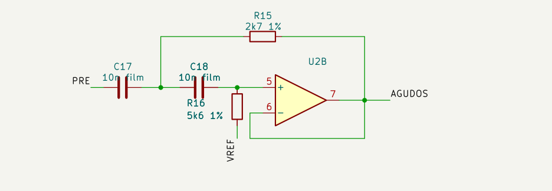
<figcaption>Filtro de agudos con U2B, C17, C18, R15 y R16.</figcaption>
</figure>

Las tolerancias de los componentes desplazan los cortes; el barrido
nominal no sustituye una prueba de tolerancias ni la medición del
montaje.

## Suma de bandas y corrección de fase

<figure>
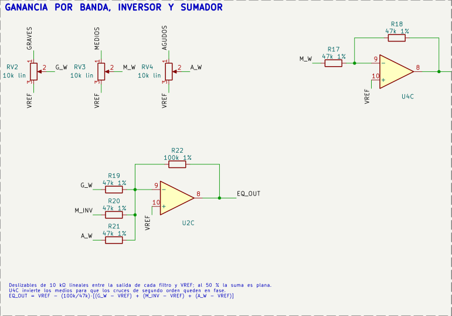
<figcaption>Deslizables, inversión de medios y sumador. Las referencias
coinciden con la PCB D.2.</figcaption>
</figure>

Cada deslizable entrega una fracción de la señal de su filtro, referida
a VREF. U4C invierte los medios antes de entrar al sumador. La salida
cumple, idealmente,
$$V_{EQ}-V_{REF}=-\frac{100}{47}\left[(V_{G_W}-V_{REF})+(V_{M_{INV}}-V_{REF})+(V_{A_W}-V_{REF})\right].$$
La magnitud de cada banda no basta para predecir la suma: también
interviene la fase. En el diseño inicial aparecieron valles de
aproximadamente 11 dB. La inversión de medios y el reajuste de sus
cortes redujeron esa irregularidad. Esta combinación no es un cruce
Linkwitz–Riley exacto; su respuesta se comprueba mediante el barrido de
la cadena completa.

## Detección de pico

<figure>
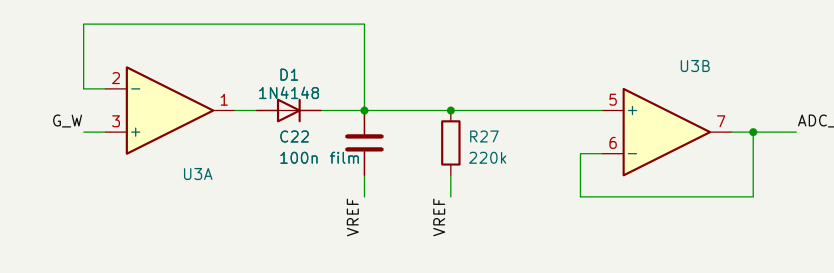
<figcaption>Detector de graves: U3A, D2, C22, R27 y seguidor
U3B.</figcaption>
</figure>

Cada detector coloca el diodo dentro de la realimentación del
operacional y usa un condensador para retener la tensión. El seguidor
posterior evita cargar ese condensador con la entrada del ADC. La
descarga tiene una constante
$$\tau=R_dC_h=220\,\mathrm{k}\Omega\cdot100\,\mathrm{nF}=22\,\mathrm{ms}.$$
La lectura es una envolvente, no un valor RMS. Entre dos picos separados
por 10 ms, la retención aislada cae a $e^{-10/22}\simeq0,635$ del valor
inicial. Esto explica por qué la lectura de graves depende del instante
de muestreo y no se debe prometer exactitud de pico uniforme a todas las
frecuencias.

## Muestreo y análisis espectral

<figure>

<figcaption>Filtro U2D entre el sumador y la entrada GPIO33 del
ESP32.</figcaption>
</figure>

Con $f_s=20\,000$ muestras/s y $N=1024$, cada bloque dura 51,2 ms y los
bins están separados por
$$\Delta f=\frac{f_s}{N}=19,53125\,\mathrm{Hz}.$$ Un tono de 1 kHz queda
próximo al bin 51, cuya frecuencia es 996,1 Hz. Una estimación
interpolada puede mostrar un valor más cercano a 1000 Hz. La ventana de
Hann reduce la fuga espectral. El firmware agrupa el resultado en 32
barras, aproximadamente entre 40 Hz y 5 kHz.

El filtro previo atenúa las componentes que podrían plegarse al
muestrear; **no elimina el aliasing**. A 15 kHz la simulación arroja
$-19,3$ dB, por lo que un tono fuerte en esa frecuencia aún puede
aparecer alrededor de 5 kHz. La visualización tampoco representa sin
atenuación toda la banda audible de 20 kHz.

Se utiliza ADC1 para evitar el conflicto entre ADC2 y Wi-Fi. La ventana
de 0,15 a 2,45 V es el margen conservador adoptado en el firmware, no
una garantía de linealidad perfecta. Se deben comprobar la calibración y
el ritmo real del muestreo en la placa. La referencia de 0 dBFS del
programa es una senoidal de 0,8 V de pico respecto a VREF.

# Arquitectura y materiales

<figure>

<figcaption>Ruta de audio y ruta de adquisición. La pantalla recibe los
resultados por SPI.</figcaption>
</figure>

Se usan cuatro MCP6004: 15 unidades procesan señales y U4D queda como
seguidor de reserva. La salida J2 es de línea; no está diseñada para
alimentar directamente audífonos pasivos. El PAM8403 mueve el parlante.
Sus dos terminales de salida forman un puente: ninguno se conecta a GND.

| Elemento         | Especificación                                                                                      |  Cant. |
|:-----------------|:----------------------------------------------------------------------------------------------------|-------:|
| Operacionales    | MCP6004-I/P y zócalo DIP-14                                                                         |      4 |
| Microcontrolador | ESP32-DevKitC V4, 38 pines                                                                          |      1 |
| Pantalla         | Waveshare 1,9 pulgadas, ST7789V2, 170 × 320, SPI                                                    |      1 |
| Resistencias     | Según BOM; filtros al 1 %                                                                           |     32 |
| Condensadores    | Según BOM; incluye C25 de 100 nF y C26 de 1000 $\mu$F/10 V                                          |     26 |
| Controles        | Tres deslizables lineales y dos rotativos de 10 k$\Omega$                                           |      5 |
| Diodos           | 1N4148                                                                                              |      3 |
| Adaptador lógico | 74AHCT125, DIP-14                                                                                   |      1 |
| Conexiones       | Dos jacks, J3–J6, cable adaptador para pantalla y pulsador                                          |  Juego |
| Audio            | PAM8403 y parlante de 4 $\Omega$, 3 W                                                               |    1+1 |
| Iluminación      | WS2812B de 5 V, 10 mm de ancho, 60 LED/m; dos tramos de 100 mm                                      | 12 LED |
| Fuente           | Regulada, 5 V / 3 A; entrada por J6                                                                 |      1 |
| Cierre           | Imanes de neodimio Ø6 × 2 mm, adhesivo compatible                                                   |      8 |
| Montaje          | PCB de una cara, puentes aislados, cables de panel, extensión USB, separadores M3, caja y difusores |  Juego |

La lista por referencia y huella está en `hardware/fabricacion/bom.csv`.
El esquema contiene 79 componentes; los módulos externos, cables y
elementos mecánicos se contabilizan aparte.

## Pantalla Waveshare y cable adaptador

El módulo tiene una envolvente nominal de 51,2 × 27,3 mm y un área
activa de 42,72 × 22,70 mm en horizontal . El firmware inicializa 170 ×
320 y gira la imagen para trabajar con 320 × 170. J4 es un conector de
2,54 mm de la PCB; no es la huella del conector GH1.25 del módulo.

| J4  | Señal del cable | ESP32 / alimentación | Pin P2 del esquema Waveshare |
|:---:|:----------------|:---------------------|:----------------------------:|
|  1  | VCC             | 3,3 V                |              8               |
|  2  | GND             | GND                  |              7               |
|  3  | DIN             | GPIO23               |              6               |
|  4  | CLK             | GPIO18               |              5               |
|  5  | CS              | GPIO5                |              4               |
|  6  | DC              | GPIO21               |              3               |
|  7  | RST             | GPIO22               |              2               |
|  8  | BL              | GPIO19               |              1               |

El adaptador debe verificarse por nombre de señal, con la serigrafía del
módulo real; no se debe confiar en colores de cable ni asumir que ambos
conectores tienen el mismo orden. No se necesita MISO. R30 mantiene BL
apagado durante el arranque.

## NeoPixel y alimentación

<figure>
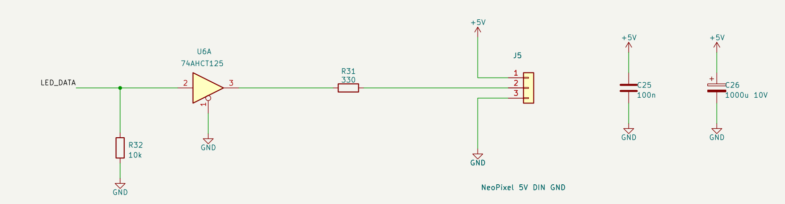
<figcaption>U6 adapta los datos a 5 V; J5 conecta la tira y J6 recibe la
fuente externa.</figcaption>
</figure>

GPIO25 controla la tira a través de U6. Se eligió 74AHCT125 porque sus
umbrales TTL permiten recibir 3,3 V con alimentación de 5 V . Las
entradas sin uso quedan fijadas y sus salidas deshabilitadas. R31 de 330
$\Omega$ limita los transitorios de datos, R32 mantiene la entrada baja
durante reset y C25 desacopla U6. C26 aporta reserva en 5 V; se debe
colocar cerca del inicio de la tira durante el montaje .

J5 lleva 5 V, DIN y GND. El retorno de potencia se lleva a la fuente,
separado del cableado de audio. El presupuesto conservador de los 12 LED
es $12\cdot60\,\mathrm{mA}=720\,\mathrm{mA}$ a blanco máximo; el
firmware arranca con brillo 32/255 y colores fijos. La fuente de 3 A
deja margen para ESP32 y amplificador. Al alimentar por J6 se desconecta
VBUS del USB; no se ponen ambas fuentes en paralelo.

# Simulación y verificación

La cadena analógica se volvió a ejecutar en ngspice. El macromodelo del
MCP6004 es una aproximación propia, basada en parámetros típicos; no es
un modelo certificado por Microchip. El conjunto incluye 23 casos del
diseño revisado y un caso histórico que reproduce el defecto de la Fase
1.

| Prueba                         | Resultado            | Interpretación                          |
|:-------------------------------|:---------------------|:----------------------------------------|
| VREF en reposo                 | 1,6412 V             | Coherente con la caída en R1            |
| Ganancia PRE/PRE_IN            | 3,20 a 1 kHz         | Coincide con el cálculo                 |
| Suma al centro, respecto a PRE | $-0,27$ a $+0,88$ dB | Dentro de $\pm1$ dB                     |
| Graves, 25 % / 100 %           | $-5,7$ / $+6,4$ dB   | Referido al control al 50 %             |
| Medios, 25 % / 100 %           | $-5,1$ / $+6,0$ dB   | Referido al control al 50 %             |
| Agudos, 25 % / 100 %           | $-5,6$ / $+6,3$ dB   | Referido al control al 50 %             |
| Detectores con tono de 1 kHz   | 15 / 304 / 17 mV     | Medios predomina; las otras no son cero |
| ADC_FFT, caso de margen        | 1,113 a 2,171 V      | Dentro de la ventana adoptada           |

<figure>

<figcaption>Barridos nominales: bandas, suma inicial y revisada, ajustes
y detector. Resultados de simulación.</figcaption>
</figure>

<figure>

<figcaption>Selectividad y linealidad simuladas. El criterio es que la
banda dominante supere al menos cuatro veces las otras, no que las otras
desaparezcan.</figcaption>
</figure>

El esquema pasa ERC sin errores ni advertencias. Las 59 redes coinciden
pin a pin con la descripción del circuito.

La revisión D.2 pasa la comprobación eléctrica DRC y la comparación con
el esquema. Las 59 redes quedan conectadas al incluir los 80 puentes. La
comparación con el esquema comprueba las conexiones de cada terminal. El
ruteo conserva una separación mínima de 1 mm y pistas de 0,9 mm o más.

Los informes están en `hardware/drc.rpt` y
`hardware/una-cara/continuidad.json`. Las comprobaciones gráficas de
serigrafía no se utilizan para certificar una impresión; no se incluye
una capa de serigrafía en fabricación.

# PCB de una cara y gabinete

La revisión D.2 usa una PCB de 200 × 120 mm. Todas las pistas se
encuentran en B.Cu. Los cruces se resuelven con 80 tramos de alambre
aislado, agrupados en JP1–JP79. JP67–JP79 se sueldan a terminales
existentes por la cara de soldadura; los demás tienen puntos de montaje
propios. Los puentes de hasta 20 mm se montan por arriba; los cables
largos y los puentes a terminales van por debajo, con aislamiento y 8 mm
de espacio libre. La guía distingue ambas caras. La separación entre
cobres es de 1 mm y las pistas tienen al menos 0,9 mm. El plano y las
coordenadas de los puntos de soldadura están en `hardware/una-cara/`.

<figure>
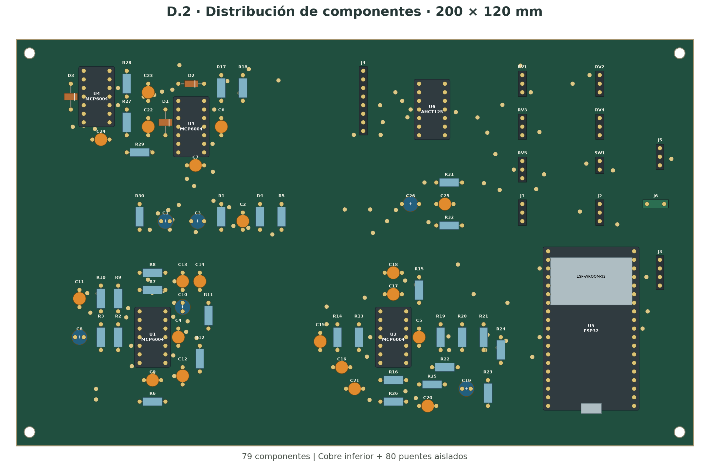
<figcaption>D.2: distribución de componentes y puentes. El esquema
completo y el plano se adjuntan al PDF.</figcaption>
</figure>

Los archivos Gerber contienen una sola capa de cobre. KiCad conserva dos
capas en su estructura interna para representar los pads pasantes, pero
no se exporta cobre superior. No hay vías de ruteo. Los controles del
panel se conectan por cable a las cabeceras. El acceso USB requiere una
extensión hasta el ESP32, orientado a la derecha.

<figure>

<figcaption>Modelo de la PCB sin los cables de puente; sus recorridos se
muestran en el plano de montaje. Se deben contrastar las huellas con los
componentes adquiridos.</figcaption>
</figure>

Los planos y renders muestran la distribución del diseño.

La envolvente se revisó con acabado grafito, rotulación compacta y
controles de menor altura. El gabinete mide 208 × 128 × 49,5 mm sin
contar las perillas. Tiene dos canales interiores de 102 × 10,6 × 3 mm
para la tira, ventanas laterales con difusores y pasos para tres
conductores. La ruta de cables evita los deslizables y mantiene los LED
separados de la entrada de audio. La cuna de la pantalla usa holgura
lateral y una ranura para el cable; sus cotas se deben contrastar con el
módulo adquirido antes de imprimir la versión final. La tapa se retiene
mediante cuatro pares de imanes de neodimio: ocho discos de Ø6 × 2 mm.
Los alojamientos tienen Ø6,3 mm y 2,2 mm de profundidad, con 0,8 mm de
material sobre los imanes de la tapa. Se fijan con adhesivo y se
verifica la polaridad antes de pegarlos. Dos tetones de registro de Ø1,8
mm entran en alojamientos de Ø2,3 mm para limitar el desplazamiento
lateral; un uñero posterior permite abrir la caja. La PCB conserva
soportes y fijación independientes. La fuerza de cierre, las tolerancias
de impresión y el cable flexible de pantalla deben probarse en el
montaje real.

<figure>

<figcaption>Vista abierta: tapa, cuna de pantalla, PCB y alojamiento
interior.</figcaption>
</figure>

<figure>
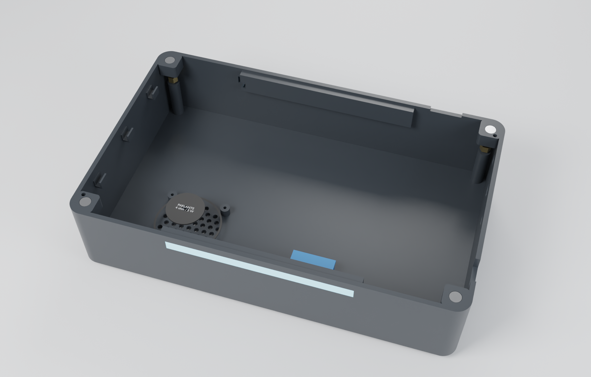
<figcaption>Canales y pasos de cables visibles al retirar la
PCB.</figcaption>
</figure>

<figure>

<figcaption>Vista superior con los controles y la pantalla de 1,9
pulgadas.</figcaption>
</figure>

# Simulación interactiva en Velxio

Se ejecutaron tres proyectos en <https://velxio.dev/editor>. En la
carpeta `simulacion/velxio/`, los archivos `filtros-100Hz.vlx`,
`filtros-1000Hz.vlx` y `filtros-8000Hz.vlx` se importan mediante *File /
Import project*. No requieren cuenta para esta demostración local en el
navegador.

Los valores de R y C corresponden a las cuatro secciones de los filtros
del esquema. Se excita PRE con 0,1 V de pico y offset de 1,65 V; los
voltímetros miden las salidas respecto a VREF. Se usan operacionales
ideales, sin límites de alimentación ni ancho de banda. La prueba
demuestra selectividad, no el funcionamiento completo del equipo ni la
precisión del MCP6004.

|   Tono |   Graves |   Medios |   Agudos | Banda predominante |
|-------:|---------:|---------:|---------:|:-------------------|
| 100 Hz | 63,17 mV |  4,65 mV |  0,22 mV | Graves             |
|  1 kHz |  6,11 mV | 63,23 mV |  4,51 mV | Medios             |
|  8 kHz |  0,64 mV |  6,15 mV | 68,31 mV | Agudos             |

Estas son las lecturas RMS mostradas por los instrumentos de Velxio
durante la ejecución; incluyen la ventana transitoria del simulador y no
se usan como patrón de amplitud en régimen permanente. En los tres casos
predominó la banda esperada. Se conservan las capturas y el registro
`validacion.json`.

<figure>
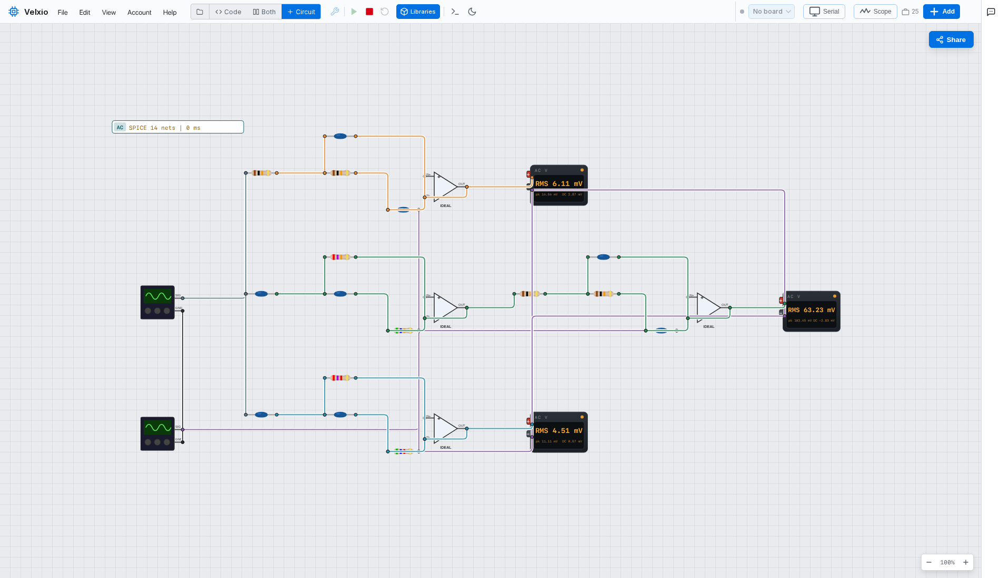
<figcaption>Ejecución de los filtros en Velxio a 1 kHz, con el motor
SPICE activo y lecturas en los tres instrumentos.</figcaption>
</figure>

[**Abrir el editor Velxio**](https://velxio.dev/editor/). El QR de la
presentación lleva al mismo enlace. Los tres casos de filtros y el
ensayo LED se adjuntan al PDF; también están disponibles mediante
`simulacion/velxio/index.html` en la copia local. Se importan después de
abrir el editor.

## Demostración con generador y osciloscopio

Para explicar los filtros se inyectan 200 mV pico a pico en PRE, con
offset de 1,65 V. Se compara PRE con la salida de la banda seleccionada:
graves a 100 Hz, medios a 1 kHz y agudos a 8 kHz. En Velxio se añade
cada canal con clic derecho sobre el cable y *Add to scope*. La ganancia
se calcula como $V_{pp,out}/V_{pp,in}$ y el desfase a partir de la
diferencia temporal entre las trazas. La guía `DEMO-HOY.md` incluye el
procedimiento de banco. Las masas del generador y de las sondas se
conectan a GND, nunca a VREF.

<figure>
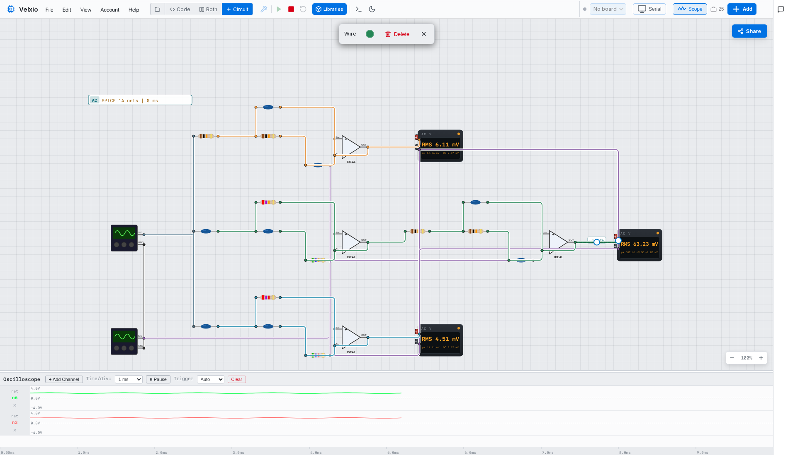
<figcaption>Captura del osciloscopio de Velxio con sondas en PRE y en la
salida de medios.</figcaption>
</figure>

## Cadena integrada con ESP32 y pantalla

Los proyectos `integrado-100Hz.vlx`, `integrado-1000Hz.vlx` y
`integrado-8000Hz.vlx` conectan la entrada, el preamplificador, los
filtros, los detectores y el ESP32 a una TFT ILI9341. Se ejecutan con
<https://velxio.dev/editor?esp32sim=qemu>. La pantalla recibe las
lecturas del ADC emulado y muestra el predominio de graves, medios y
agudos ante los tres tonos, respectivamente.

La ILI9341 sustituye a la Waveshare en el simulador. Se utilizan
operacionales ideales y diodos genéricos sin ruptura inversa; los
potenciómetros se representan con sus dos mitades resistivas. Los
valores y redes de las etapas se generan desde la misma descripción del
circuito. La guía `INTEGRADO.md` explica las equivalencias y el
procedimiento.

**Límite de esta comprobación:** la FFT de la emulación no está
calibrada en frecuencia. No se usa su estimación como resultado de
medida. Tampoco se modelan el PAM8403 ni la adaptación eléctrica de los
NeoPixel. La selectividad y el recorrido hasta la pantalla no equivalen
a validar ruido, distorsión o tolerancias del equipo físico.

<figure>
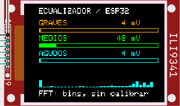
<figcaption>TFT alimentada por las lecturas del ESP32 emulado a 1 kHz;
predomina la banda de medios.</figcaption>
</figure>

## Ensayo animado de iluminación

El archivo `led-animado.vlx` ejecuta en Velxio un programa del ESP32 que
controla 12 NeoPixel desde GPIO25. La secuencia recorre la tira cada 160
ms por paso, con cuatro LED naranjas, cuatro verdes y cuatro cian. Se
comprobó la ejecución de los doce pasos en el monitor serie y la matriz
de una fila por doce LED. El brillo está limitado a 32/255.

Este ensayo usa un patrón programado, sin señal de audio. El modelo no
reproduce el 74AHCT125 ni la corriente de la fuente; esas comprobaciones
quedan para el montaje. El firmware principal conserva la iluminación
fija durante la adquisición.

<figure>
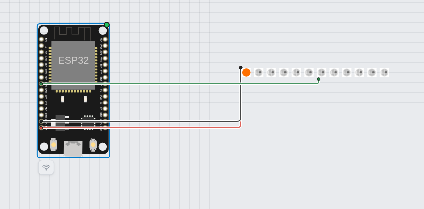
<figcaption>Ensayo ejecutado en Velxio: ESP32 y tira de doce
LED.</figcaption>
</figure>

# Guion de demostración

1.  Mostrar en el simulador el reposo de VREF y la salida del
    preamplificador. Indicar siempre si la amplitud es pico, pico a pico
    o RMS.

2.  Aplicar 100 Hz, 1 kHz y 8 kHz. Comparar las tres salidas de detector
    y señalar la banda predominante.

3.  Mostrar el barrido con controles al centro y compararlo con el caso
    original. Explicar la inversión de medios.

4.  Abrir la PCB y el modelo 3D. Mostrar los canales NeoPixel, la cuna
    de la Waveshare y los accesos de alimentación.

9 J. Karki. *Analysis of the Sallen-Key Architecture*. Texas
Instruments, SLOA024B.
<https://www.ti.com/lit/an/sloa024b/sloa024b.pdf>. Microchip. *MCP6004:
1 MHz, Low-Power Op Amp*.
<https://www.microchip.com/en-us/product/mcp6004>. Analog Devices.
*ADAU1701: SigmaDSP Audio Processor*.
<https://www.analog.com/en/products/adau1701.html>. WLED Project. *Audio
Reactive WLED*. <https://kno.wled.ge/advanced/audio-reactive/>.
Waveshare. *1.9inch LCD Module*, ficha y esquema.
<https://www.waveshare.com/wiki/1.9inch_LCD_Module>;
<https://files.waveshare.com/upload/7/7f/1.9inch_LCD_Module.pdf>. Texas
Instruments. *SN74AHCT125*, SCLS264R.
<https://www.ti.com/lit/ds/symlink/sn74ahct125.pdf>. Adafruit. *NeoPixel
Überguide: Best Practices*.
<https://learn.adafruit.com/adafruit-neopixel-uberguide/best-practices>.
Velxio. *Documentación del simulador*. <https://velxio.dev/docs/>.

