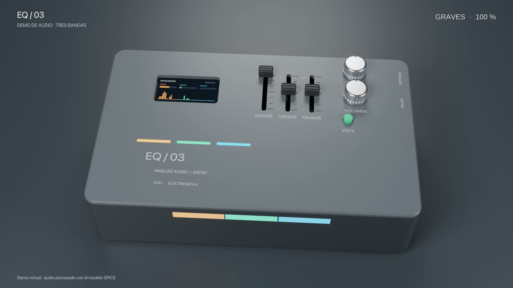

# Video del ecualizador E.5 con sonido

**[Reproducir el video](ecualizador-animado.mp4)** — 64 segundos, 1920 × 1080, 24 fps, H.264 con audio AAC de 48 kHz. Muestra el montaje vigente: **cuatro tarjetas perforadas y cinco controles rotativos, y los cinco se mueven y se oyen**. No hay potenciómetros deslizables ni PCB única; el video anterior (revisión D.2) fue reemplazado.



| Tiempo | Qué se ve y se escucha |
|---|---|
| 0–4 s | Producto cerrado: tapa con cinco perillas, pantalla ESP32-3248S035 de 3,5", dos rejillas de parlante y tres barras de luz. |
| 4–7 s | Detalle de los controles: NIVEL, GRAVES, MEDIOS, AGUDOS y VOLUMEN. |
| 7–14 s | NIVEL (RV1, A10K **pendiente de compra**): centro, mínimo, máximo y vuelta al centro. Cambia el volumen **y** los medidores de la pantalla: actúa antes de los filtros. |
| 14–21 s | GRAVES (RV2, B10K): la misma secuencia. |
| 21–28 s | MEDIOS (RV3, B10K). |
| 28–35 s | AGUDOS (RV4, B10K). |
| 35–38 s | Pulsador VISTA: la pantalla pasa de «TRES BANDAS» a «ESPECTRO». |
| 38–45 s | VOLUMEN (RV5, A10K **pendiente de compra**) con el espectro en pantalla: cambia **lo que suena, no lo que mide** — va después del punto de medida. |
| 45–48 s | La tapa imantada se levanta basculando sobre su borde frontal; los arneses la siguen. |
| 48–58 s | Interior: cuatro tarjetas y arneses, T2 con LM324 y PAM8403, parlantes en la tapa, T4 con el ESP32 DevKit V1 30P (pendiente de compra) y el 74HCT245. |
| 58–64 s | Se cierra la tapa y termina con el producto cerrado. |

## Qué es fiel y qué no

- **Geometría.** Sale del CAD E.5 (`hardware/E5-perforadas/3d/`), que a su vez sale de `medidas-componentes.json`. Las piezas son envolventes; varias cotas siguen sin medir.
- **Controles.** Giran los cinco: RV2–RV4 son los B10K de banda comprados; NIVEL (RV1) y VOLUMEN (RV5) son A10K logarítmicos que **no se han comprado** — su movimiento y su efecto sonoro son parte del modelo de diseño, no de un equipo real; en el interior se dibujan en ámbar. El cuarto B10K es repuesto y no aparece.
- **NIVEL y VOLUMEN: ley logarítmica supuesta.** Los A10K no están comprados ni medidos, así que su efecto usa una ley dB-lineal **supuesta** de 30 dB de recorrido, aplicada como ±15 dB respecto al punto RV1 = RV5 = 0,5 con el que se calculó el banco SPICE. NIVEL multiplica la señal **antes** de los filtros: cambia el audio y también lo que miden la pantalla y los detectores de banda. VOLUMEN va de LINEA a la entrada del amplificador, **después** del punto de medida: cambia solo lo que suena, y esa asimetría (deliberada) se ve en el video — con VOLUMEN al mínimo el espectro de la pantalla sigue igual.
- **Sonido.** `generar_audio.py` crea una composición original y la filtra con las respuestas AC que ngspice calcula para el circuito LM324 en once posiciones de cada potenciómetro de banda. Es una aproximación cuasiestática de pequeña señal: no modela ruido de contacto, saturación, el PAM8403, los parlantes ni la acústica del gabinete. Hay una sola ganancia de reproducción para todo el clip. Los porcentajes del rótulo son recorrido del cursor, no ganancia en dB.
- **Difusores.** Relieve hexagonal impreso, de geometría propia e inspirado en el Duality Infinity 3DHex de Andy Huot. En el render las celdas (0,5 mm) se ven más claras que los nervios (1,1 mm); es una aproximación visual, no una simulación óptica.
- **Pantalla.** Es la ESP32-3248S035 de 3,5" (320 × 480) montada en vertical, **recibida el 2026-11-24**; su firmware todavía no existe y el enlace de datos previsto es ESP-NOW desde el ESP32 DevKit V1 30P de T4, que sí está **pendiente de compra**. Lo que se ve es una propuesta de interfaz dibujada por `generar_tft.py` a 1,5× (480 × 720) para que el texto del render sea legible. Los valores que muestra (dB por banda, picos, barras del espectro) sí los calcula el código real del firmware (`firmware/lib/dsp`) compilado en el PC, alimentado con el bloque de 1024 muestras a 20 kS/s y los picos por banda que resultan del modelo.
- **Luces.** Como en `firmware/src/main.cpp`: 12 píxeles lógicos fijos —4 naranja, 4 verdes, 4 azules— con brillo moderado. **No reaccionan al audio.** Físicamente son tres tramos de 200 mm de la tira FCOB WS2811 de 12 V. El render no demuestra que el equipo pueda alimentarla: falta resolver los 12 V.
- **Tapa.** Cierra con imanes y no tiene bisagras: en el video queda abierta sin apoyo, cosa que en la realidad exige sostenerla.
- **Cableado.** Los 82 conductores van de terminal a terminal, pero su recorrido y longitud son ilustrativos.

Es un **render de un modelo de diseño con audio calculado**. No es una grabación del prototipo, no prueba que el firmware corra en la placa y no sustituye pruebas eléctricas ni mecánicas. La revisión visual y las métricas están en [REVIEW.md](REVIEW.md).

## Archivos

| Archivo | Contenido |
|---|---|
| `ecualizador-animado.mp4` | Video final con sonido |
| `ecualizador-animado.blend` | Escena editable de Blender 5.3 (rutas relativas) |
| `ecualizador-blender.zip` | Escena, audio y fotogramas de pantalla listos para abrir en otro equipo |
| `tft-fotogramas/` | 1536 PNG de 480 × 720: interfaz propuesta para la ESP32-3248S035 (320 × 480 a 1,5×) |
| `demo-audio.wav` · `demo-entrada.wav` | Audio procesado que lleva el video · composición antes del circuito (a otro nivel; no sirve para comparar ganancia) |
| `respuestas-spice.npz` | Respuestas complejas de ngspice: LINEA, G_W, M_W, A_W y ADC_FFT_RAW |
| `demo-timeline.json` | Posición de los cinco controles, vista de pantalla y picos por banda en cada fotograma |
| `demo-subtitulos.ass` | Rótulos sincronizados |
| `validacion-audio.json` | Datos del modelo de audio, incluido el efecto de NIVEL y VOLUMEN |
| `hoja-de-contacto.jpg` | 24 fotogramas extraídos del MP4 final |
| `../validacion/video-dispositivo.json` | Validación de CAD, escena, MP4, audio y textos |

## Regenerar

Desde la raíz del repositorio. Requiere FreeCAD 1.1, Blender 5.3, FFmpeg, g++, las bibliotecas de PlatformIO del firmware (`pio pkg install -d firmware -e e4`) y un Python con NumPy, SciPy y Pillow (sirve el de FreeCAD: `/Applications/FreeCAD.app/Contents/Resources/bin/python`). ngspice solo hace falta si se borra `respuestas-spice.npz`: con el archivo presente, `generar_audio.py` lo reutiliza (las respuestas de banda no dependen de NIVEL ni de VOLUMEN, que son ganancias escalares fuera de los filtros).

```sh
# 1. CAD y vistas fijas
freecadcmd hardware/E5-perforadas/3d/generar_modelo.py
blender -b -P hardware/E5-perforadas/3d/render_modelo.py -- cerrado abierto planta detalle

# 2. Audio, datos de pantalla y fotogramas de la TFT
python hardware/E5-perforadas/video/generar_audio.py
python hardware/E5-perforadas/video/generar_tft.py

# 3. Escena y fotogramas (horas; reanuda si se interrumpe)
rm -rf docs/video/frames
blender -b -P hardware/E5-perforadas/video/video_blender.py

# 4. MP4, validación y paquetes
bash hardware/E5-perforadas/video/exportar_video.sh
python hardware/E5-perforadas/video/validar_entrega.py
python hardware/E5-perforadas/video/empaquetar_blender.py
python herramientas/empaquetar_exposicion.py
```

`BUILD_ONLY=1` guarda solo el `.blend`; `PREVIEW=1,300,860` saca fotogramas sueltos; `RANGO=1-300` renderiza un tramo. Los movimientos están en `hardware/E5-perforadas/video/timeline.py` y las cámaras en `video_blender.py`. `docs/video/frames/` no se versiona: hay que borrarla al cambiar la animación para no mezclar versiones.

Los guiones del video anterior siguen en `cad/`, archivados; ya no escriben en esta carpeta (ver `cad/LEEME-ARCHIVO.md`).
