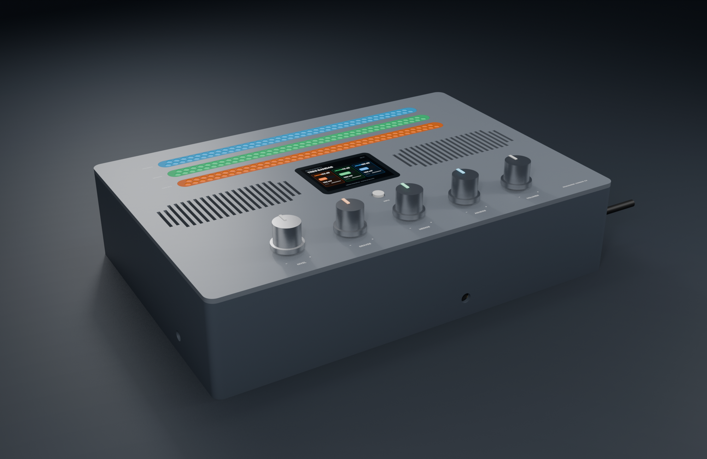
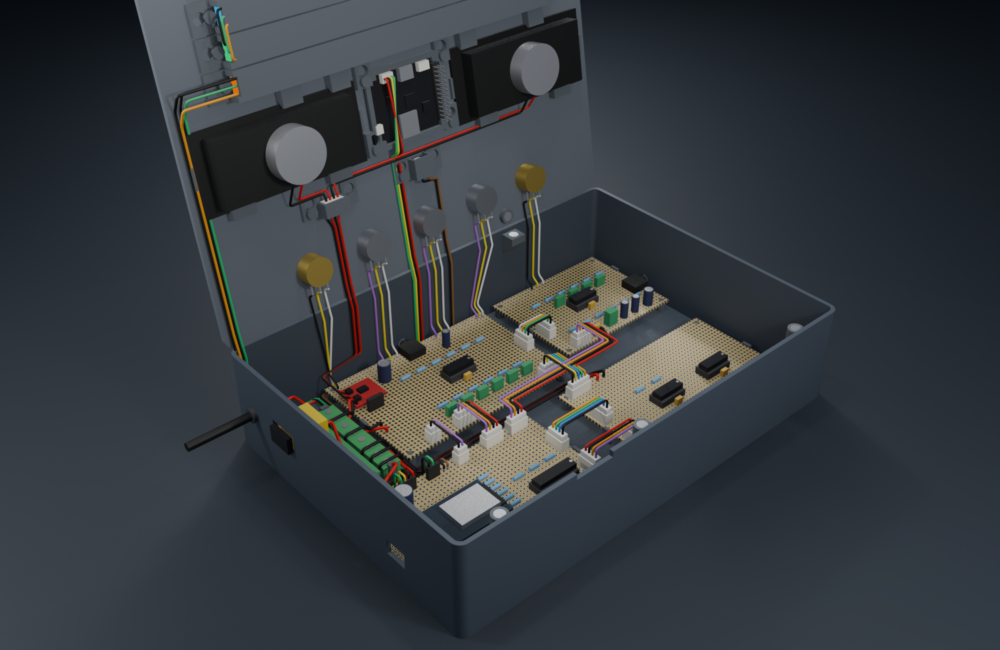
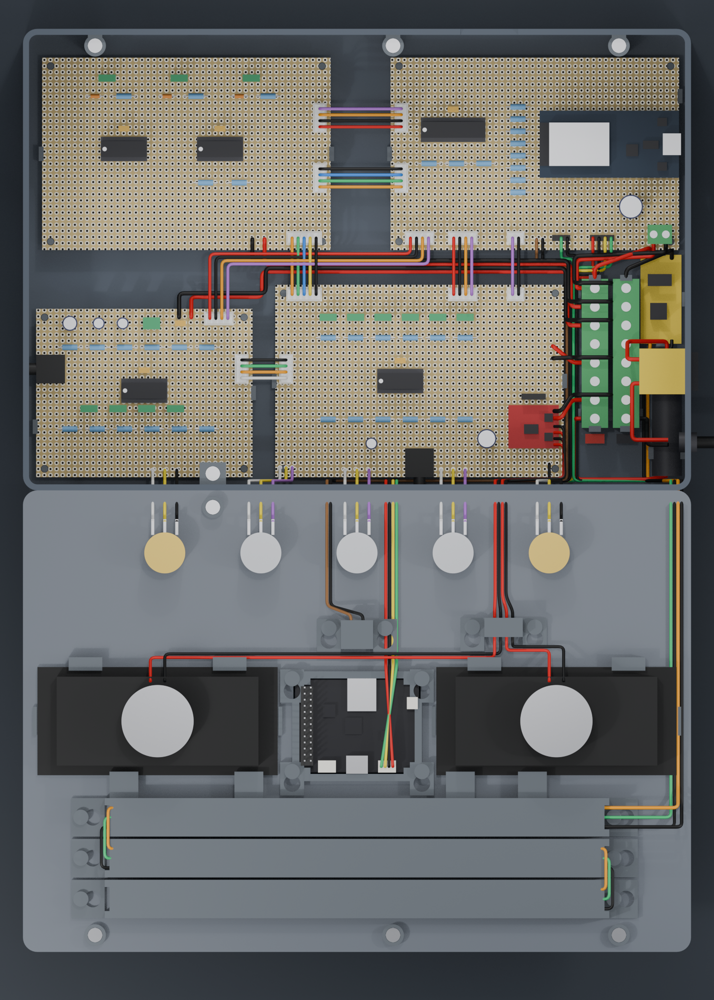

# Modelo 3D E.5 · tarjetas perforadas y controles rotativos

Ensamble mecánico del montaje vigente: cuatro tarjetas perforadas separadas dentro de
un gabinete de 278 × 192 × 64 mm con tapa de cierre magnético (sin bisagras ni tornillos). **No hay
potenciómetros deslizables ni PCB única**; el gabinete antiguo de `cad/` y la PCB
E.4/D.2 no se usan como referencia.

| Vista cerrada | Vista abierta | Planta desplegada |
|---|---|---|
|  |  |  |

Estas vistas fijas son la referencia visual vigente. El video E.5 se conserva como histórico porque su
interior es anterior a los encastres actuales.

## Qué representa

- **Tapa:** cinco controles rotativos en fila — NIVEL (RV1), GRAVES (RV2), MEDIOS (RV3),
  AGUDOS (RV4), VOLUMEN (RV5) —, pantalla LilyGO T4-S3 (AMOLED de 2,41″, en horizontal, 600 × 450; vidrio de 56 × 44 mm al ras de la tapa), pulsador
  VISTA (SW1), dos parlantes con rejilla y tres barras de luz con difusor de relieve hexagonal.
- **Cierre:** cuatro pares de imanes de Ø6 × 2 mm (tres postes traseros y una ménsula frontal)
  y un uñero trasero. La tapa bascula sobre su borde frontal; nada la sostiene abierta.
- **Difusores:** cada barra lleva un difusor impreso con relieve hexagonal: fondo de 0,5 mm,
  nervio de 1,1 mm, celdas de 5 mm en dos filas y patrón que se repite cada 25 mm (medio píxel
  de la tira). La idea viene del [Duality Infinity 3DHex](https://www.youtube.com/watch?v=t1xqIwvpk8I)
  de Andy Huot; la geometría es propia. Sus piezas no se usan: la pista Duality mide unos 36 mm
  de ancho y aquí las barras van a 17 mm entre centros, y su licencia es solo de uso personal.
  Imprimir en blanco con la pestaña sobre la cama; la lámina superior cruza en puente 9,2 mm.
  La pestaña queda apretada entre la cuna de la tira y la tapa. Los extremos de cada barra son
  semicirculares, igual que su ventana en la tapa.
- **Perillas:** metálicas (aluminio). Siguen pendientes de compra; el modelo usa una envolvente supuesta.
- **Pantalla:** la T4-S3 es una placa ESP32-S3 completa. Sustituye a la TFT ST7789 y se enlaza
  con el ESP32 por un arnés de cuatro hilos (+5 V, GND, TX, RX). Es una **propuesta**: no está
  en el esquema ni existe firmware para ese enlace. No está comprada.
- **RV2–RV4:** tres B10K lineales rotativos montados. El cuarto B10K es repuesto y no
  aparece en el modelo.
- **RV1 y RV5:** A10K logarítmicos **pendientes de compra**. Se dibujan en ámbar, con el
  nombre `…A10K_log_PENDIENTE_COMPRA…` y con la envolvente del B10K como supuesto; la cota
  está pendiente de medir. Los dos P-20K logarítmicos comprados son solo candidatos.
- **Interior:** T1–T4 con sus zócalos, LM324, 74HCT245, 40 resistencias, 26 capacitores,
  3 diodos, ESP32S V1.1 USB-C de 38 pines sobre zócalos, PAM8403, jacks de 3,5 mm,
  bornera J6, cabezales XH y headers.
- **Cableado:** 82 conductores: arneses XH entre tarjetas (JAB, JBC, JB4, JC4, 3 × JBUS),
  tres hilos por potenciómetro, enlace UART de la pantalla, pulsador, cuatro hilos de parlantes, tira, y la estrella de
  +5 V/GND desde dos borneras puente con portafusible sujeto e interruptor.
- **Luces:** tira BTF-LIGHTING FCOB WS2811 de **12 V**, 720 LED/m, 12 mm de ancho, un
  píxel cada 50 mm (ASIN B0BW5T6HW4, variante verificada). Los 12 píxeles lógicos del
  firmware ocupan 600 mm, así que se cortan tres tramos de 200 mm: uno por banda.

Los componentes son envolventes mecánicas en posiciones representativas. No es una
colocación agujero por agujero ni sustituye pruebas eléctricas o mecánicas.

## Archivos

| Archivo | Contenido |
|---|---|
| `medidas-componentes.json` | Cotas, su origen (publicada / conservadora / supuesto) y evidencia de compra |
| `e5_layout.py` | Fuente geométrica única: posiciones, piezas y trazado de cables |
| `generar_modelo.py` | FreeCAD: `.FCStd`, `.step`, `stl/` y `validacion-3d.json` |
| `escena_blender.py` | Escena de Blender de las vistas fijas; también la reutiliza el video histórico |
| `render_modelo.py` | Vistas cerrada, abierta, planta, detalle de controles y soporte de pantalla explotado |
| `generar_interfaz_render.py` / `tft-render-horizontal.png` | Interfaz horizontal estática propuesta para los renders |
| `ecualizador-E5-pantalla-soporte-explotado.png` | Orden de montaje: tapa de prueba → T4-S3 → placa trasera desmontable |
| `ecualizador-E5-perforadas.FCStd` / `.step` | Ensamble editable e intercambio |
| `bambu/` | Proyectos 3MF para Bambu Studio (probetas de ajuste, piezas, cuerpo, tapa y uno combinado), con las piezas ya orientadas (ver abajo) |
| `exportar_bambu.py` | Genera `bambu/` a partir de `stl/` |
| `pruebas-de-ajuste/` | Probetas recortadas de la geometría real para comprobar encajes antes de imprimir cuerpo y tapa |
| `stl/` | Piezas imprimibles: cuerpo, tapa, cunas de tira, difusores, cuna y capuchón de SW1, placa trasera desmontable de la T4-S3 |
| `validacion-3d.json` | Comprobaciones dimensionales y lista de pendientes |
| `validacion-renders.json` / `validar_renders.py` | Integridad, resolución y vigencia de las cinco vistas |
| `BEST-PRACTICES.md` | Reglas propias del E.5 para fuentes de verdad, encastres, impresión y renders |
| `MEDIDAS-COMPRADAS.md` | Qué falta medir antes de perforar o imprimir |

## Regenerar

Desde la raíz del repositorio, con FreeCAD 1.1 y Blender 5.1:

```sh
freecadcmd hardware/E5-perforadas/3d/generar_modelo.py
python3 hardware/E5-perforadas/3d/generar_interfaz_render.py
blender -b -P hardware/E5-perforadas/3d/render_modelo.py -- cerrado abierto planta detalle pantalla-soporte
python3 hardware/E5-perforadas/3d/validar_renders.py
```

El primer paso valida antes de escribir y se detiene si una comprobación falla. Para
cambiar una medida se edita `medidas-componentes.json`; para mover algo, `e5_layout.py`.
El render usa Cycles en GPU (`MUESTRAS=96` por defecto; `MOTOR=BLENDER_EEVEE` si no hay GPU).

## Decisiones de diseño que conviene revisar

- **Tapa que bascula por el frente.** Los arneses cruzan por el borde frontal, así los
  potenciómetros quedan a menos de 12 cm de T1/T2, como pide la regla de cables analógicos
  cortos. El enlace UART de la pantalla recorre unos 37 cm, aceptable para UART.
- **Pantalla por UART.** ESP32 GPIO17 (TX2) → T4-S3 GPIO44 (RX); ESP32 GPIO16 (RX2) ← T4-S3
  GPIO43 (TX); +5 V al pin VBUS de la T4-S3; GND común. Ambas placas trabajan a 3,3 V. J4, R30
  y los pines SPI del ESP32 quedarían libres. Falta esquema y firmware en las dos placas.
- **SW1 y PAM8403.** SW1 va en una cuna bajo la tapa con dos hilos a T4; el PAM8403
  se monta sobre pines en T2 junto a J3.
- **Alimentación.** La fuente de 5 V es externa; entra por un pasacable, pasa por el
  interruptor y el portafusible y llega a las dos borneras puente (rotuladas +5V y GND).

## Imprimir con Bambu Studio

```bash
freecadcmd hardware/E5-perforadas/3d/generar_modelo.py
python3 hardware/E5-perforadas/3d/exportar_bambu.py          # cama de 256 x 256 (P2S, P1, X1, A1)
CAMA=350x320 python3 hardware/E5-perforadas/3d/exportar_bambu.py   # H2D: cuerpo y tapa acostados
bambu-studio "$PWD/hardware/E5-perforadas/3d/bambu/E5-completo-generado.3mf"   # ruta absoluta: con relativa falla
```

El script solo reescribe sus propios archivos; para guardar cambios hechos en Bambu Studio, usar otro nombre
(por ejemplo `E5-completo.3mf`), que el script no toca.

Bambu Studio cambia de carpeta al arrancar: con una ruta relativa responde "Loading of a model file failed".

| Archivo | Contenido | Orientación |
|---|---|---|
| `bambu/E5-completo-generado.3mf` | Las cuatro camas en un solo proyecto, con soportes activados: probetas, piezas pequeñas, cuerpo y tapa | Las de cada cama |
| `bambu/E5-pruebas-de-ajuste.3mf` | 12 probetas de ajuste (ver abajo) | Acostadas; ocupan 222 × 151 mm |
| `bambu/E5-piezas-pequenas.3mf` | 3 difusores, 3 cunas de tira, placa trasera desmontable de la T4-S3, cuna de SW1, cuna del conector de parlantes, capuchón | Cunas boca abajo |
| `bambu/E5-cuerpo.3mf` | Cuerpo de una pieza | De canto sobre la pared trasera, en diagonal; necesita soportes |
| `bambu/E5-tapa.3mf` | Tapa de una pieza | De canto sobre el borde trasero, en diagonal; necesita soportes |

Son proyectos de Bambu Studio con solo geometría: el script escribe un 3MF genérico, la CLI de
Bambu Studio lo reescribe (la interfaz gráfica rechaza el genérico con "The file does not contain
any geometry data") y se le quita la configuración de proyecto. Al abrirlos, Bambu Studio avisa
"loading geometry data only" y conserva la impresora, el filamento y el proceso que tengas
elegidos. Comprobado abriendo los tres en Bambu Studio 2.05 con una P2S de boquilla 0,2: las
piezas aparecen sobre la cama y todas las mallas son cerradas (`manifold = yes`).
**No se ha laminado ni impreso ninguno.**

`E5-completo-generado.3mf` es distinto: Bambu Studio solo respeta varias camas si el proyecto trae ajustes, así
que lleva los de sistema de la P2S (boquilla 0,2, proceso 0,10 mm Standard, PLA Basic). Se cambian en
Bambu Studio o al generar, con las variables `IMPRESORA`, `PROCESO` y `FILAMENTO`. Comprobado que abre
con sus camas.

### Probetas de ajuste: imprimir primero

Son recortes de la tapa, el cuerpo y las barras tal como están en el CAD, con sus encastres, así que
prueban las holguras reales. Imprimirlas con el mismo filamento y perfil que se usará después.

| Probeta | Qué se comprueba con la pieza real |
|---|---|
| `tapa_potenciometro_B10K` | El buje roscado M7 del B10K entra en el agujero de 7,4 mm y la tuerca aprieta sobre 3 mm de tapa |
| `tapa_pantalla_T4S3_y_SW1` | El vidrio asienta al ras y el PCB pasa por el hueco. Trae las seis setas: probar en ella la placa trasera desmontable de la T4-S3 y la cuna de SW1 de la cama 2 |
| `tapa_ventana_barra_LED` + `barra_difusor_tramo` + `barra_cuna_tramo` | El difusor entra en la ventana y queda al ras; la cuna corre sobre la seta y hace clic; la tira de 12 mm queda bajo las uñas |
| `tapa_teton_iman` + `cuerpo_poste_iman_punta` | El imán de 6 × 2 entra a presión entre los nervios y no se sale; los dos se atraen |
| `cuerpo_esquina_tarjeta_T1` | El pin entra en el agujero de la perforada y el gancho sujeta el canto |
| `cuerpo_pinza_portafusible` | El portafusible entra a presión en la pinza |
| `pared_der_interruptor_y_pasacable` | El interruptor encaja en su ventana de 19 × 13 y el pasacable en el agujero de 8,4 mm |
| `pared_der_USB_C` | El conector del cable USB-C pasa por la ventana de 14 × 9,4 |
| `pared_izq_jack_3p5` | La rosca del jack de 3,5 mm entra en el agujero de 6,6 mm |

Las probetas no comprueban posiciones relativas (por ejemplo, si el USB-C del ESP32S queda frente a su
ventana), la sujeción de los parlantes ni el cierre de la tapa completa.

## Encastres: nada va pegado ni atornillado

| Qué | Cómo se sujeta |
|---|---|
| Tarjetas perforadas | Cuatro postes con pin por los agujeros de esquina y dos ganchos en voladizo por tarjeta |
| Borneras puente y elevador | Guías bajas y dos ganchos por los extremos |
| Portafusible | Dos pinzas abiertas por arriba |
| Imanes | Alojamientos con cuatro nervios de apriete (0,3 mm de interferencia), en postes del cuerpo y tetones de la tapa |
| Cunas de tira, cuna de SW1, cuna del conector de parlantes, placa trasera de la T4-S3 | Seta de la tapa + ojo de cerradura: la pieza baja por el ojo ancho y se corre 5 mm hasta hacer clic |
| Difusores | Su pestaña queda apretada entre el escalón de la cuna y la tapa |
| Tira LED | Bajo uñas de la cuna (no hace falta su adhesivo) |
| Parlantes | Canto delantero bajo dos cuñas de la tapa; el trasero lo atrapan las cuñas de la cuna de GRAVES |
| Capuchón de SW1 | Reborde en la base: no sale por fuera de la tapa |
| Potenciómetros, jacks, interruptor, pasacable | Su propia tuerca o su propio clip de panel |

Postes, ganchos, pinzas, setas, cuñas y tetones salen fundidos en los STL del cuerpo y de la tapa.

Orden de montaje en la tapa (boca abajo): capuchón de SW1 en su agujero; T4-S3; placa trasera sobre sus
cuatro setas y deslizada 5 mm hacia el borde trasero hasta hacer clic; cuna de
SW1, parlantes (canto delantero bajo las cuñas), difusores en sus ventanas, cunas de AGUDOS y MEDIOS y,
al final, la de GRAVES, que traba los parlantes. Cuna del conector en cualquier momento.

Pendiente de validar: todas las holguras (0,1 mm por lado en el cuello del ojo, uñas de 0,6 mm en los
ganchos) son de diseño y dependen del filamento; el espesor del marco de los parlantes (2 mm) y la
posición de los agujeros de las perforadas son supuestos; los cables del CAD no se han vuelto a trazar
alrededor de las piezas nuevas.

## Cuerpo y tapa en la P2S: de una pieza, de canto y con soportes

El gabinete mide 278 × 192 mm y la cama de la P2S 256 × 256: de una pieza no cabe acostado. Por defecto
cuerpo y tapa van de canto sobre su borde trasero, en diagonal. En el proyecto combinado esos dos objetos
llevan como ajuste propio soportes de árbol y borde de adherencia de 8 mm (pestaña Objects); el ajuste global
queda sin soportes, para no ponérselos a las piezas pequeñas. Si Bambu Studio avisa de "floating regions",
marcar Support → Enable support en esos dos objetos. Laminado con la CLI de Bambu Studio 2.05 (P2S, boquilla 0,2, capa 0,10 mm, PLA Basic):

| Pieza | Filamento con soportes | Tiempo estimado |
|---|---|---|
| Cuerpo | 365 g | 61 h |
| Tapa | 152 g | 27 h |

Con boquilla de 0,4 y capa de 0,20 mm el tiempo baja mucho; no se ha laminado así. No se ha impreso nada.
Qué esperar de esta orientación: los ganchos, postes, setas y cuñas del interior nacen en voladizo y quedan
apoyados en soportes que hay que retirar; la pared delantera del cuerpo es un techo a 192 mm; la tapa es
una lámina de 3 mm de pie, a la que conviene añadir borde de adherencia (brim).

Alternativas:

- `CAMA=350x320` (H2D u otra cama grande): cuerpo y tapa acostados, sin soportes.
- `MITADES=1`: cuerpo y tapa en dos mitades con cola de milano en x = 139 mm, acostadas y sin soportes,
  cada mitad con un filamento (`COLORES="#A8452B,#E6E3DC"`). Queda una junta visible con tres colas de
  milano en la tapa. Los STL de las mitades se generan siempre en `stl/*_mitad_*.stl`.
